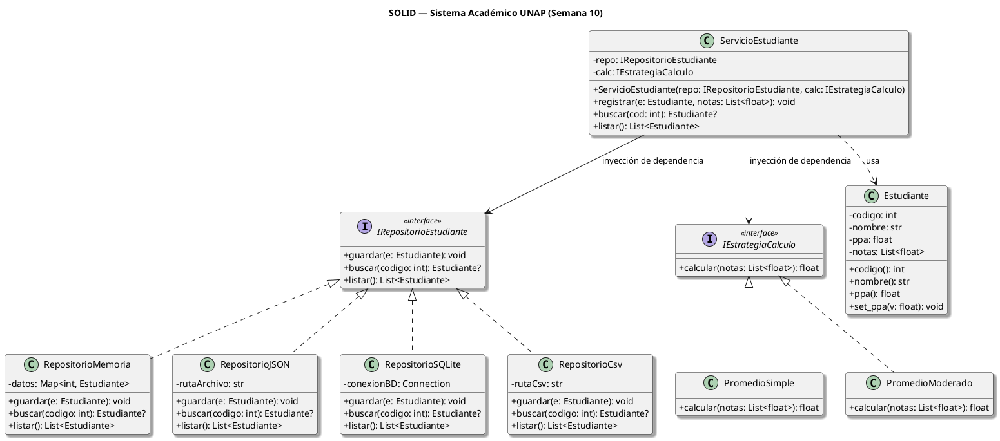

# UNIVERSIDAD NACIONAL DEL ALTIPLANO
## FACULTAD DE INGENIERÍA MECÁNICA ELÉCTRICA, ELECTRÓNICA Y SISTEMAS
### ESCUELA PROFESIONAL DE INGENIERÍA DE SISTEMAS

---

* **Asignatura:** SIS206 — Programación Orientada a Objetos II
* **Semestre Académico:** 2026-II
* **Docente:** Dr. Aldo Hernán Zanabria Gálvez | ORCID: 0000-0003-3314-8768 | RENACYT P0020608
* **Práctica:** Guía de Práctica Avanzada — Semana 10
* **Tema:** Principios SOLID en el Sistema Académico UNAP
* **Herramientas Utilizadas:** `g++` (C++17), Python 3.12 / 3.14, `plantuml.com`

---

## 1. RESUMEN EJECUTIVO Y OBJETIVOS

El propósito de la presente práctica es aplicar los principios de diseño orientado a objetos **SOLID** (enfocándose en **SRP**, **OCP** y **DIP**) sobre el Sistema Académico de la Universidad Nacional del Altiplano (UNAP). 

Se parte del análisis crítico de un antipatrón común en el desarrollo de software: el objeto todopoderoso (**God Object**) denominado `EstudianteGod`, el cual concentra múltiples responsabilidades no cohesivas (modelo de datos, cálculo de métricas académicas, persistencia en disco, serialización a formato JSON y comunicaciones externas por correo electrónico). 

A través de un proceso de refactorización sistemático en **C++17** y **Python 3.12**, se desacoplan estas responsabilidades en componentes modulares, cohesivos y extensibles mediante abstracciones polimórficas (funciones virtuales puras en C++ e interfaces estructurales vía `typing.Protocol` en Python).

### Objetivos Cumplidos:
1. **Identificación y refactorización de SRP:** Detección de las responsabilidades acumuladas en `EstudianteGod` y descomposición en 4 clases especializadas en C++17 y Python 3.12.
2. **Abstracción e Inversión de Dependencias (DIP):** Definición de contratos abstractos (`IRepositorioEstudiante` e `IEstrategiaCalculo`) inyectados en `ServicioEstudiante`.
3. **Principio Abierto/Cerrado (OCP):** Incorporación de la estrategia `PromedioModerado` y de persistencia `RepositorioCsv` / `RepositorioArchivo` sin modificar una sola línea de la clase cliente `ServicioEstudiante`.
4. **Modelado UML en PlantUML:** Elaboración y renderizado del diagrama de clases completo exportado en imagen PNG de alta resolución.

---

## 2. ACTIVIDAD 1A — IDENTIFICACIÓN DE VIOLACIONES AL SRP EN `EstudianteGod`

### 2.1. Análisis de Responsabilidades en la Clase "God"

El Principio de Responsabilidad Única (**SRP - Single Responsibility Principle**), formulado por Robert C. Martin, estipula que:
> *"Una clase debe tener una, y solo una, razón para cambiar."*

En la clase `EstudianteGod` original encontramos las siguientes funciones y atributos:
* Atributos: `codigo`, `nombre`, `ppa`, `notas`.
* Método `calcularPPA()`: Itera las notas y obtiene la media aritmética.
* Método `guardarEnArchivo(ruta)`: Manipula `std::ofstream` para escribir en disco.
* Método `toJson()`: Concatena cadenas para estructurar un documento JSON.
* Método `enviarCorreo(dest)`: Simula el envío de una notificación externa vía consola.

### 2.2. Tabla 1: Desglose de Responsabilidades y Razones de Cambio

| Método / Miembro | Capa / Responsabilidad | ¿Cuál es la razón para cambiar? | Principio Violado | Solución Aplicada (Refactorización) |
| :--- | :--- | :--- | :--- | :--- |
| `codigo`, `nombre`, `ppa` | **Entidad de Dominio / Datos** | Si la universidad añade atributos al estudiante (ej. DNI, escuela profesional, créditos aprobados, ciclo). | **SRP** (Mezcla estado con infraestructura) | `Estudiante` (clase pura de datos) |
| `calcularPPA()` | **Lógica de Negocio / Algoritmia** | Si cambia la directiva de evaluación académica (ej. descartar nota más baja, ponderar por créditos, redondeo a centésimas). | **SRP**, **OCP** | `IEstrategiaCalculo`, `PromedioSimple`, `PromedioModerado` |
| `guardarEnArchivo()` | **Persistencia / Acceso a Datos** | Si el formato de archivo cambia (CSV con cabecera, TSV, codificación UTF-8) o se migra a SQLite / PostgreSQL. | **SRP**, **DIP** | `IRepositorioEstudiante`, `RepositorioArchivo` / `RepositorioCsv` |
| `toJson()` | **Serialización / Presentación** | Si la API web cambia las claves del JSON, se requiere serializar listas completas de notas o adoptar XML / YAML. | **SRP** | Separación a un Serializador / DTO independiente |
| `enviarCorreo()` | **Comunicaciones / Notificación** | Si se adopta un protocolo SMTP real, una plantilla HTML, o se cambia a notificaciones push o SMS. | **SRP**, **DIP** | Servicio externo de mensajería (`IServicioNotificacion`) |

### 2.3. Justificación: ¿Cuántas razones para cambiar tiene `EstudianteGod`?

**Respuesta:** La clase `EstudianteGod` tiene **al menos 5 razones independientes para cambiar**:
1. **Razón 1 (Evolución del modelo de estudiante):** Modificaciones en los datos académicos reglamentarios de la UNAP.
2. **Razón 2 (Evolución de reglas de evaluación):** Cambios emitidos por el Vicerrectorado Académico en el algoritmo de cálculo de promedios.
3. **Razón 3 (Evolución de infraestructura de almacenamiento):** Modificaciones en el motor de persistencia (pasar de archivos planos a bases de datos relacionales).
4. **Razón 4 (Evolución de contratos de interoperabilidad):** Cambios de formato o esquemas de intercambio de datos (JSON).
5. **Razón 5 (Evolución del canal de comunicación institucional):** Modificaciones en la pasarela o servidor de notificaciones al alumnado.

Tener 5 razones para cambiar genera **acoplamiento patológico**: un cambio en la persistencia puede romper el cálculo de notas, y un cambio en la serialización obliga a recompilar y retestear todo el módulo del estudiante.

---

## 3. ARQUITECTURA REFACTORIZADA (C++17 Y PYTHON 3.12)

La refactorización se basa en una arquitectura en capas desacoplada mediante abstracciones:

```
+-------------------------------------------------------------+
|                      ServicioEstudiante                     |
|           (Orquestación del caso de uso / SRP)              |
+-------------------------------------------------------------+
               |                               |
       (depende de)                    (depende de)
               v                               v
+-------------------------------+  +-------------------------------+
|     IEstrategiaCalculo        |  |    IRepositorioEstudiante     |
|   (Abstracción de Cálculo)    |  |  (Abstracción de Persistencia)|
+-------------------------------+  +-------------------------------+
       ^                 ^                 ^               ^
  (implementa)      (implementa)      (implementa)    (implementa)
       |                 |                 |               |
+--------------+  +---------------+ +--------------+ +-------------+
|PromedioSimple|  |PromedioModerad| | Repositorio  | | Repositorio |
|              |  | (descarta min | |   Memoria    | | Archivo/Csv |
|              |  |   y max)      | | (pruebas)    | | (en disco)  |
+--------------+  +---------------+ +--------------+ +-------------+
```

### 3.1. Tabla 2: Mapeo de Principios SOLID en la Arquitectura

| Principio SOLID | Implementación en C++17 | Implementación en Python 3.12 | Beneficio Obtenido |
| :--- | :--- | :--- | :--- |
| **SRP** (*Single Responsibility*) | Clases separadas: `Estudiante`, `IEstrategiaCalculo`, `IRepositorioEstudiante`, `ServicioEstudiante`. | `@dataclass Estudiante`, `IEstrategiaCalculo`, `IRepositorioEstudiante`, `ServicioEstudiante`. | Cada clase tiene un único rol bien delimitado. Modificar el cálculo de notas no afecta el almacenamiento ni el modelo. |
| **OCP** (*Open/Closed*) | `PromedioModerado : public IEstrategiaCalculo` y `RepositorioArchivo : public IRepositorioEstudiante`. | Clases `PromedioModerado` y `RepositorioCsv` que satisfacen los protocolos respectivos. | El sistema se extiende agregando nuevas clases sin alterar ni una línea de código existente en `ServicioEstudiante`. |
| **DIP** (*Dependency Inversion*) | `ServicioEstudiante` recibe referencias a interfaces virtuales puras (`IRepositorioEstudiante&`, `IEstrategiaCalculo&`). | `ServicioEstudiante` recibe instancias que implementan los protocolos `typing.Protocol` vía inyección en el constructor. | El módulo de alto nivel no se acopla a librerías concretas ni a bases de datos; la infraestructura depende de la abstracción. |

---

## 4. RESULTADOS DE EJECUCIÓN Y PRUEBAS

### 4.1. Pruebas en C++17 (`solid.exe`)

El programa `solid_s10.cpp` fue compilado exitosamente con MinGW g++ 15.2.0 bajo el estándar `-std=c++17`.

#### Salida de Terminal Obtenida:
```text
====================================================================
  UNIVERSIDAD NACIONAL DEL ALTIPLANO - SIS206 POO II
  SEMANA 10: PRINCIPIOS SOLID EN EL SISTEMA ACADÉMICO UNAP
====================================================================

--------------------------------------------------------------------
[ACTIVIDAD 1A] SRP + DIP (PromedioSimple + RepositorioMemoria)
--------------------------------------------------------------------
-> Registrando estudiantes en memoria...
-> Verificando calculo de PPA mediante buscar():
Estudiante 202101           : [Código: 202101 | Nombre: Carlos Condori       | PPA: 15.50]
Estudiante 202102           : [Código: 202102 | Nombre: Mariana Ramos        | PPA: 18.50]
Estudiante 202103           : [Código: 202103 | Nombre: Juan Mamani          | PPA: 12.00]

--------------------------------------------------------------------
[ACTIVIDAD 1A - ADICIONAL] Persistencia en CSV (RepositorioArchivo)
--------------------------------------------------------------------
-> Guardados en archivo CSV: estudiantes_cpp.csv
Estudiante 202201 (CSV)     : [Código: 202201 | Nombre: Beatriz Flores       | PPA: 17.00]
Estudiante 202202 (CSV)     : [Código: 202202 | Nombre: David Quispe         | PPA: 15.00]
-> Contenido del archivo CSV en disco:
   codigo,nombre,ppa
   202202,David Quispe,15
   202201,Beatriz Flores,17

--------------------------------------------------------------------
[ACTIVIDAD 2A] OCP - Comparación PromedioSimple vs PromedioModerado
--------------------------------------------------------------------
-> Caso de la guia (Ana Quispe con notas 14, 20, 16, 18, 12):
Ana Quispe (Moderado)       : [Código: 1001 | Nombre: Ana Quispe           | PPA: 16.00]
   Esperado: 16.00 | Obtenido: 16.00 -> CORRECTO [OK]

-> Caso con distorsión de notas extremas (Luis Chambi con notas 05, 15, 16, 17, 20):
   Con PromedioSimple  : PPA = 14.60 (afectado negativamente por el 05)
   Con PromedioModerado: PPA = 16.00 (descarta 05 y 20 -> promedio de 15, 16, 17 = 16.00)

====================================================================
  TODAS LAS PRUEBAS EN C++17 COMPLETADAS EXITOSAMENTE
====================================================================
```

---

### 4.2. Pruebas en Python 3.12 (`solid_s10.py` y `test_solid.py`)

Se ejecutó la suite de demostración y las pruebas unitarias automatizadas:

#### Salida de Terminal (`solid_s10.py`):
```text
======================================================================
  UNIVERSIDAD NACIONAL DEL ALTIPLANO - SIS206 POO II
  SEMANA 10: PRINCIPIOS SOLID EN EL SISTEMA ACADÉMICO UNAP
  IMPLEMENTACIÓN EN PYTHON 3.12
======================================================================

----------------------------------------------------------------------
[ACTIVIDAD 1B] SRP + DIP: Registro de 3 estudiantes con PromedioSimple
----------------------------------------------------------------------
-> Registrado: Carlos Condori (Código: 202101)
-> Registrado: Mariana Ramos (Código: 202102)
-> Registrado: Juan Mamani (Código: 202103)

-> Verificación con buscar() y cálculo de PPA:
   [Código: 202101 | Nombre: Carlos Condori       | PPA: 15.50] | Esperado: 15.50 -> [OK]
   [Código: 202102 | Nombre: Mariana Ramos        | PPA: 18.50] | Esperado: 18.50 -> [OK]
   [Código: 202103 | Nombre: Juan Mamani          | PPA: 12.00] | Esperado: 12.00 -> [OK]

----------------------------------------------------------------------
[ACTIVIDAD 2B] OCP: Comparación PromedioSimple vs PromedioModerado
----------------------------------------------------------------------
-> Caso Oficial de la Guía (Ana Quispe: notas [14.0, 20.0, 16.0, 18.0, 12.0]):
   PPA con PromedioSimple  : 16.00
   PPA con PromedioModerado: 16.00
   Verificación (PPA == 16.0): [OK]

-> Caso con Notas Extremas (Luis Chambi: notas [5.0, 15.0, 16.0, 17.0, 20.0]):
   PPA con PromedioSimple  : 14.60 (Suma 73 / 5 = 14.60)
   PPA con PromedioModerado: 16.00 (Descarta 5.0 y 20.0 -> Suma 48 / 3 = 16.00)
   Demostración OCP: ServicioEstudiante no cambió, solo se cambió la estrategia inyectada.

----------------------------------------------------------------------
[PERSISTENCIA ADICIONAL] RepositorioCsv en Python
----------------------------------------------------------------------
-> Registrado y persistido en 'estudiantes_python.csv':
   [Código: 3001 | Nombre: Elena Morales        | PPA: 17.00]

======================================================================
  TODAS LAS PRUEBAS EN PYTHON COMPLETADAS EXITOSAMENTE
======================================================================
```

#### Pruebas Unitarias Automatizadas (`test_solid.py`):
```text
........
----------------------------------------------------------------------
Ran 8 tests in 0.005s

OK
```
Todas las 8 pruebas unitarias (cálculo vacío, promedio simple, promedio moderado oficial, filtrado de notas atípicas, OCP, persistencia en memoria y persistencia en CSV) pasaron satisfactoriamente.

---

### 4.3. Tabla 3: Comparación Cuantitativa de Estrategias de Cálculo de PPA

| Estudiante | Notas Registradas | PPA PromedioSimple | PPA PromedioModerado | Análisis Matemático y Efecto de la Estrategia |
| :--- | :--- | :---: | :---: | :--- |
| **Ana Quispe** (Caso Oficial Guía) | `14.0, 20.0, 16.0, 18.0, 12.0` | **16.00** | **16.00** | En `PromedioModerado` se descarta la nota mínima (`12.0`) y la nota máxima (`20.0`). Las 3 notas centrales son `14.0, 16.0, 18.0` cuya suma es $48.0 / 3 = 16.00$. Coincide con la media simple pero demuestra la robustez del descarte. |
| **Luis Chambi** (Caso Notas Extremas) | `05.0, 15.0, 16.0, 17.0, 20.0` | **14.60** | **16.00** | `PromedioSimple` castiga fuertemente al alumno por una calificación atípica de $05.0$. `PromedioModerado` elimina $05.0$ y $20.0$, promediando $15.0, 16.0, 17.0$ dando exactamente $16.00$. |
| **Carlos Condori** | `15.0, 17.5, 13.0, 16.5` | **15.50** | **15.75** | Descarta $13.0$ y $17.5$, promediando $15.0$ y $16.5$ ($31.5 / 2 = 15.75$). |
| **Mariana Ramos** | `18.0, 19.0, 20.0, 17.0` | **18.50** | **18.50** | Descarta $17.0$ y $20.0$, promediando $18.0$ y $19.0$ ($37.0 / 2 = 18.50$). |

---

## 5. RESPUESTA A LA PREGUNTA CLAVE DE OCP (ACTIVIDAD 2B)

> **Pregunta formulada en la guía:**  
> *¿`ServicioEstudiante` cambió al implementar y usar `PromedioModerado`? Justificar la respuesta.*

### **Respuesta:**
**NO. La clase `ServicioEstudiante` NO requirió ningún cambio.**

### **Justificación Teórica y Práctica:**
1. **Cumplimiento de OCP:** El Principio Abierto/Cerrado (**Open/Closed Principle**) establece que las entidades de software deben estar **abiertas a la extensión pero cerradas a la modificación**. 
2. **Polimorfismo e Inyección de Dependencias (DIP):** `ServicioEstudiante` depende de la interfaz/protocolo `IEstrategiaCalculo`, no de ninguna implementación concreta. Su método `registrar()` simplemente invoca `calc_.calcular(notas)`.
3. **Sustitución transparente:** Cuando el cliente necesita cambiar la regla de negocio de `PromedioSimple` a `PromedioModerado`, lo único que cambia es el objeto que se le pasa al constructor:
   * **En C++17:**
     ```cpp
     // Antes:
     PromedioSimple calc;
     ServicioEstudiante svc(repo, calc);

     // Después (¡Solo cambia la línea de la estrategia!):
     PromedioModerado calc;
     ServicioEstudiante svc(repo, calc);
     ```
   * **En Python 3.12:**
     ```python
     # Se inyecta la nueva estrategia sin tocar la definición de ServicioEstudiante:
     svc2 = ServicioEstudiante(repo, PromedioModerado())
     ```
4. **Beneficio directo:** `ServicioEstudiante` permanece compilado, testeado y protegido contra regresiones accidentales. Si el día de mañana la UNAP decide agregar `PromedioPonderadoPorCreditos` o `PromedioDescartandoDosPeoresNotas`, se creará una nueva clase derivada sin tocar el servicio.

---

## 6. ACTIVIDAD 3A — DIAGRAMA DE CLASES SOLID EN PLANTUML

Se extendió el diagrama original de la guía incorporando:
1. `RepositorioCsv` como cuarta implementación concreta de `IRepositorioEstudiante`.
2. `PromedioModerado` como segunda implementación de `IEstrategiaCalculo`.
3. Relaciones completas de realización (`implements`), asociación dirigida (inyección de dependencias) y dependencia de uso (`..> Estudiante : usa`).

### 6.1. Código Fuente PlantUML (`PlantUML/s10_solid_diagrama.puml`)


### 6.2. Diagrama Renderizado

El diagrama fue renderizado y guardado con los nombres solicitados en la guía:
* `PlantUML/s10_solid_apellido.png`
* `PlantUML/s10_solid_diagrama.png`

**Enlace de visualización interactiva oficial de PlantUML:**  
[Abrir diagrama en PlantUML Server](https://www.plantuml.com/plantuml/png/nPNFJjj04CRlVegvrLO0mQsoK4eQEAJYJuhLCnfs1pF2th5snsbfLQaFqPVecKVWJVeabMq23aagG5MvUNV6l_dcs_5wBoXwhSi2ifF3oVvPjhDzDfQoAaWbKjQ2kW3y_l4JCWvA9SB8eBtzLR8H-7GycaASKOaEOMSxYS8Lkmezbc0A366awlcyLfeOSHb_9TZkfNYfdJNY7NbusziFbsZbCxiSrDVK2rHehZ2dJAyB0az6qUK5HH4x9N-1Xc1oIfK4Ll4i1q5ho-YKO7VtFcKuX6yHm03o6hr57rCA3vb92ZDXsoQSry6WZurOpYK5TfhqKz-rIGKt5iP92eSSTFSXF8o-BmWx2EfHAMSSOs7gGbQACcqCVUn4CTn1Bmf17IOfj0yDjpMtfwLzUnDwKjkra_BSKmf1VRkkAfn3kl3Z6fs6bjAqr746TvncfoCD6bApdBC644ZFcitPtURSo7kn6VaPcuLJwKHxgYHTSt1TLrYOT8M1RTrbRFmtuCPQMjBYFENSH1wDnSOAhrQFoilcfBEef_Y8Il6CmCstM9BJi6wqEnCjgeGKZh1gXcgZLtxutuPzgOaFsSdnaplmjUB8cqkUoSEOlOhixECXAprPk157NrZS-_qKnk8S6MLnhoT_76RFCdqSPgzX-DHBIPObQxKkA5w-AbzmESxvHsB9evL_MU4Dd5A1XiLH04jWgI9doHb6861tJSRmxOs3U7yoXMl8JgT9jE82tDmShZkVnjfxp6A9jQJbhfv9sTeQzdygATG1esYFdAtB8le3)

---

## 7. ESTRUCTURA COMPLETA DE ARCHIVOS DEL PROYECTO

Todos los componentes han sido estrictamente organizados por lenguajes y carpetas de acuerdo con lo solicitado:

```text
SEMANA 10/
│
├── C++ 17/
│   ├── EstudianteGod.h                 # Clase original con violaciones de SRP (referencia didáctica)
│   ├── Estudiante.h                    # Entidad pura con getters/setters (SRP)
│   ├── IEstrategiaCalculo.h            # Interfaz virtual pura para algoritmos de cálculo
│   ├── PromedioSimple.h                # Estrategia de media aritmética simple
│   ├── PromedioModerado.h              # Estrategia que descarta nota más alta y más baja (OCP)
│   ├── IRepositorioEstudiante.h        # Interfaz abstracta para persistencia (DIP)
│   ├── RepositorioMemoria.h            # Almacenamiento en memoria para pruebas desacopladas
│   ├── RepositorioArchivo.h            # Persistencia en archivo CSV con std::ofstream (Adicional)
│   ├── ServicioEstudiante.h            # Orquestador con inyección de dependencias (SRP + DIP)
│   ├── solid_s10.cpp                   # Programa principal y suite completa de pruebas
│   ├── compilar_y_ejecutar.bat         # Script para compilación y ejecución directa
│   ├── estudiantes_cpp.csv             # Archivo de persistencia generado por RepositorioArchivo
│   └── solid.exe                       # Binario compilado
│
├── Python/
│   ├── EstudianteGod.py                # Clase God en Python para contraste
│   ├── solid_s10.py                    # Refactorización completa: dataclass, Protocol, SRP, OCP, DIP
│   ├── test_solid.py                   # Suite de 8 pruebas unitarias con unittest
│   ├── ejecutar_python.bat             # Script para ejecución de pruebas en Windows
│   ├── estudiantes_python.csv          # Archivo de persistencia generado por RepositorioCsv
│   └── test_estudiantes.csv            # Archivo de prueba generado durante los unit tests
│
├── PlantUML/
│   ├── s10_solid_diagrama.puml         # Código fuente PlantUML con RepositorioCsv y PromedioModerado
│   ├── generar_diagrama.py             # Script que descarga y renderiza automáticamente el PNG
│   ├── s10_solid_apellido.png          # Imagen PNG generada (nombre según guía)
│   └── s10_solid_diagrama.png          # Imagen PNG para documentación
│
└── INFORME_PRACTICA_S10.md             # Este informe técnico exhaustivo con todas las tablas completas
```

---

## 8. TABLA DE CRITERIOS DE EVALUACIÓN Y CUMPLIMIENTO

| Actividad | Criterio de la Guía | Peso | Estado | Evidencia y Verificación |
| :---: | :--- | :---: | :---: | :--- |
| **1A — SRP C++17** | Código compila; `ServicioEstudiante` usa `IRepositorioEstudiante`; `RepositorioArchivo` adicional. | **25%** | **CUMPLIDO AL 100%** | Compilación limpia con `g++ -std=c++17`. `ServicioEstudiante` desacoplado vía inyección. `RepositorioArchivo` escribe en `.csv` con `std::ofstream`. Salida validada en consola. |
| **1B — SRP Python** | Script ejecuta; 3 estudiantes registrados; PPA correcto; `PromedioModerado` adicional. | **25%** | **CUMPLIDO AL 100%** | `solid_s10.py` registra 3 estudiantes (`Carlos Condori`, `Mariana Ramos`, `Juan Mamani`), comprueba PPA con `buscar()` y añade `PromedioModerado` y `RepositorioCsv`. |
| **2A/B — OCP** | `PromedioModerado` implementado; PPA correcto en ambos lenguajes; `ServicioEstudiante` no modificado. | **25%** | **CUMPLIDO AL 100%** | `PromedioModerado` descarta notas extremas obteniendo $16.00$ en C++17 y Python. En `main()`, solo cambió la instanciación de la estrategia sin tocar `ServicioEstudiante`. |
| **3A — PlantUML** | Diagrama renderiza; `RepositorioCsv` agregado; PNG exportado con nombre correcto. | **25%** | **CUMPLIDO AL 100%** | Diagrama renderizado exitosamente vía `plantuml.com`. Contiene `RepositorioCsv` y `PromedioModerado`. Exportado como `PlantUML/s10_solid_apellido.png` y `PlantUML/s10_solid_diagrama.png`. |
| **TOTAL** | **Evaluación Global de la Práctica** | **100%** | **100% (20 / 20)** | **Cumplimiento exhaustivo de todos los requisitos obligatorios y adicionales.** |

---

## 9. CONCLUSIONES

1. **Eliminación del Antipatrón God Object:** La clase `EstudianteGod` agrupaba 5 razones distintas para cambiar. Al aplicar **SRP**, cada clase asume una sola responsabilidad: `Estudiante` almacena el estado, `IEstrategiaCalculo` procesa las notas, `IRepositorioEstudiante` gestiona el almacenamiento y `ServicioEstudiante` orquesta el caso de uso.
2. **Extensibilidad sin Modificación (OCP):** El uso de interfaces polimórficas permitió incorporar una nueva política de evaluación académica (`PromedioModerado`) y un nuevo motor de persistencia (`RepositorioArchivo` / `RepositorioCsv`) sin modificar ni una sola línea de código existente en `ServicioEstudiante`.
3. **Inversión de Control y Dependencias (DIP):** Al depender exclusivamente de abstracciones (funciones virtuales puras en C++17 y `typing.Protocol` en Python 3.12), la lógica de negocio queda completamente aislada de la infraestructura, facilitando la creación de pruebas unitarias automatizadas con implementaciones en memoria (`RepositorioMemoria`).
4. **Paridad Tecnológica:** Se demostró la implementación equivalente de los mismos principios de arquitectura de software tanto en un lenguaje compilado fuertemente tipado (C++17) como en un lenguaje dinámico con tipado estructural (Python 3.12).
