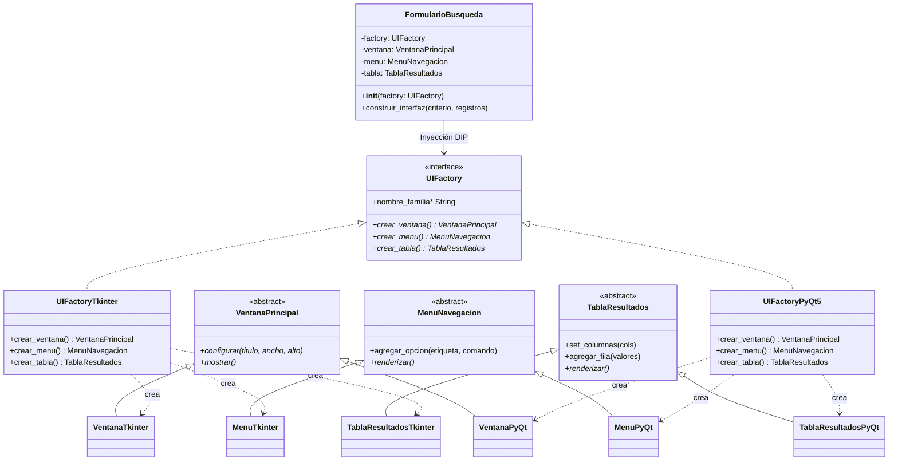

# UNIVERSIDAD NACIONAL DEL ALTIPLANO - PUNO
## Facultad de Ingeniería Mecánica Eléctrica, Electrónica y Sistemas
### Escuela Profesional de Ingeniería de Sistemas

---

# INFORME DE PRÁCTICA DE LABORATORIO — SEMANA 11
## PATRONES DE DISEÑO GOF I: SINGLETON, FACTORY METHOD Y ABSTRACT FACTORY

* **Curso:** Programación Orientada a Objetos II (SIS206)
* **Docente:** Dr. Aldo Hernán Zanabria Gálvez (ORCID: 0000-0003-3314-8768 | RENACYT: P0020608)
* **Semestre:** 2026-II

---

## ÍNDICE DEL INFORME
1. [Actividad 1: Singleton — Logger (C++17) y Configuración (.env en Python)](#actividad-1)
2. [Actividad 2: Factory Method — Generador de Boletas Académicas](#actividad-2)
3. [Actividad 3: Abstract Factory — UI Multiplataforma (Tkinter y PyQt5)](#actividad-3)
4. [Actividad 4: Integración GoF + SOLID — Análisis Crítico y Cuadro Resuelto](#actividad-4)
5. [Actividad 5: Proyecto Final — Fábrica de Capas de la Aplicación y Tests con Mocks](#actividad-5)
6. [Resumen de Archivos y Evidencia de Pruebas Automatizadas](#resumen-de-archivos)

---

<a name="actividad-1"></a>
## 1. ACTIVIDAD 1: SINGLETON — LOGGER Y CONFIGURACIÓN

### 1.1 Implementación en C++17 (Meyers Singleton Thread-Safe)
Se implementó un `Logger` centralizado y seguro para concurrencia en [logger.hpp](file:///c:/backup/PROGRAMACIÓN ORIENTADA A OBJETOS 2/PRACTICAS SEMANALES  POO2/SEMANA 11/actividad1/logger.hpp) y se verificó con [test_logger.cpp](file:///c:/backup/PROGRAMACIÓN ORIENTADA A OBJETOS 2/PRACTICAS SEMANALES  POO2/SEMANA 11/actividad1/test_logger.cpp).
* **Constructor privado:** Bloquea la instanciación directa (`Logger(...)`).
* **Supresión de copia y movimiento:** Se marcan con `= delete` tanto el constructor de copia como el operador de asignación (`Logger(const Logger&) = delete;`).
* **Inicialización Thread-Safe (Meyers):** Se aprovecha la garantía del estándar C++11/C++17 en variables estáticas de ámbito de función (`static Logger inst;`).
* **Sincronización:** Cada escritura a archivo y consola está protegida mediante `std::lock_guard<std::mutex>`.

### 1.2 Implementación en Python 3.12+ (Metaclase con archivo `.env`)
Se implementó `SingletonMeta` y `ConfiguracionApp` en [configuracion.py](file:///c:/backup/PROGRAMACIÓN ORIENTADA A OBJETOS 2/PRACTICAS SEMANALES  POO2/SEMANA 11/actividad1/configuracion.py) leyendo el archivo plano de variables [.env](file:///c:/backup/PROGRAMACIÓN ORIENTADA A OBJETOS 2/PRACTICAS SEMANALES  POO2/SEMANA 11/actividad1/.env).
* **Metaclase `SingletonMeta`:** Intercepta el método `__call__` de la clase y utiliza un `threading.Lock()` para garantizar que únicamente se instancie un objeto en la primera invocación, incluso ante múltiples hilos concurrentes.
* **Carga de variables simulada:** Lee `DB_URL`, `MAX_CONEXIONES`, `AMBIENTE`, `DEBUG_MODE`, `PUERTO_SERVICIO` y `TIMEOUT_SEGUNDOS`.

### 1.3 Verificación con `assert` y `pytest`
* **En C++:** `assert(&Logger::instancia() == &Logger::instancia())` verificado con éxito y prueba multihilo con 8 hilos concurrentes.
* **En Python:** 4 pruebas automatizadas en [test_singleton.py](file:///c:/backup/PROGRAMACIÓN ORIENTADA A OBJETOS 2/PRACTICAS SEMANALES  POO2/SEMANA 11/actividad1/test_singleton.py) (`test_singleton_misma_instancia`, `test_carga_valores_env`, `test_singleton_thread_safety`, `test_acceso_por_llave_e_inexistente`).

### 1.4 Pregunta Teórica: Singleton y DIP (Principio de Inversión de Dependencias)
> **Respuesta en 3 líneas:**
> 1. El patrón Singleton clásico viola el Principio de Inversión de Dependencias (DIP) porque los módulos clientes se acoplan rígidamente a una clase concreta mediante llamadas directas a métodos estáticos (ej. `Logger::instancia()`), dependiendo de un detalle de bajo nivel en lugar de una abstracción.
> 2. Este acoplamiento rígido obstaculiza el aislamiento en pruebas unitarias al hacer imposible sustituir la instancia global por dobles de prueba (mocks o stubs).
> 3. Se mitiga definiendo una interfaz abstracta (`ILogger`) e inyectando la instancia única a través del constructor o de un contenedor de Inversión de Control (IoC / Dependency Injection), controlando el ciclo de vida sin depender de invocaciones estáticas globales dentro de la clase de negocio.

---

<a name="actividad-2"></a>
## 2. ACTIVIDAD 2: FACTORY METHOD — GENERADOR DE DOCUMENTOS ACADÉMICOS

Se diseñó e implementó un sistema de generación y emisión de boletas de notas académicas bajo el patrón **Factory Method** y el patrón **Registry**:

### 2.1 Componentes Implementados
1. **Producto Abstracto (`BoletaNotas`):** Define los métodos `agregar_nota(curso, nota, creditos)`, `generar()`, propiedades abstractas `extension` y `formato`, y calcula automáticamente el total de créditos, promedio ponderado y condición de aprobación (≥ 11.0).
2. **Productos Concretos:**
   * `BoletaTXT`: Formato columnar textual para terminal o impresión directa.
   * `BoletaCSV`: Formato delimitado por comas estructurado para importación en hojas de cálculo.
   * `BoletaHTML`: Documento web estilizado con diseño responsivo, tablas CSS y badges condicionales de color según aprobación.
3. **Creador Base (`GeneradorBoleta`):**
   * *Factory Method:* `crear_boleta() -> BoletaNotas` (abstracto).
   * *Template Method:* `generar_y_enviar(...)` orquesta la construcción de la boleta, la inserción de las asignaturas, la serialización y el guardado en disco sin conocer la clase concreta del reporte.
4. **Creadores Concretos:**
   * `GeneradorBoletaTXT`
   * `GeneradorBoletaCSV`
   * `GeneradorBoletaHTML`
5. **Registro Dinámico (`RegistroGeneradores`):** Mapeo dinámico `formato -> Creador` que demuestra el cumplimiento del **Principio Open/Closed (OCP)**, permitiendo registrar nuevos formatos (ej. JSON o PDF) en tiempo de ejecución sin modificar ninguna clase existente.
6. **Configuración JSON:** Archivo [config_boletas.json](file:///c:/backup/PROGRAMACIÓN ORIENTADA A OBJETOS 2/PRACTICAS SEMANALES  POO2/SEMANA 11/actividad2/config_boletas.json) que parametriza los formatos a iterar (`["txt", "csv", "html"]`), el estudiante de prueba y las calificaciones semestrales.
7. **Versión C++17 Adicional:** Para máxima rigurosidad técnica, se implementó también la versión homóloga completa en C++17 en [generador_boletas.cpp](file:///c:/backup/PROGRAMACIÓN ORIENTADA A OBJETOS 2/PRACTICAS SEMANALES  POO2/SEMANA 11/actividad2/generador_boletas.cpp).

* Código Python: [boletas.py](file:///c:/backup/PROGRAMACIÓN ORIENTADA A OBJETOS 2/PRACTICAS SEMANALES  POO2/SEMANA 11/actividad2/boletas.py)
* Script ejecutor: [main_boletas.py](file:///c:/backup/PROGRAMACIÓN ORIENTADA A OBJETOS 2/PRACTICAS SEMANALES  POO2/SEMANA 11/actividad2/main_boletas.py)
* Suite de pruebas: [test_boletas.py](file:///c:/backup/PROGRAMACIÓN ORIENTADA A OBJETOS 2/PRACTICAS SEMANALES  POO2/SEMANA 11/actividad2/test_boletas.py)

---

<a name="actividad-3"></a>
## 3. ACTIVIDAD 3: ABSTRACT FACTORY — UI MULTIPLATAFORMA

Implementación de familias consistentes de componentes gráficos para el sistema de escritorio:

### 3.1 Productos Abstractos
* `VentanaPrincipal`: Configuración de geometría, título y bucle de renderizado.
* `MenuNavegacion`: Registro de acciones y comandos de menú.
* `TablaResultados`: Definición de cabeceras de columnas e inserción de tuplas de datos.

### 3.2 Familias Concretas y Fábricas
1. **Familia Tkinter (`UIFactoryTkinter`):** Crea `VentanaTkinter`, `MenuTkinter` y `TablaResultadosTkinter`.
2. **Familia PyQt5 (`UIFactoryPyQt5`):** Crea `VentanaPyQt`, `MenuPyQt` y `TablaResultadosPyQt`.

### 3.3 Código Cliente Agnóstico (`FormularioBusqueda`)
El cliente recibe `UIFactory` por inyección de dependencias en su constructor. Toda la instanciación de ventanas, menús y tablas se delega a la fábrica abstracta:
```python
form_tk = FormularioBusqueda(UIFactoryTkinter())
form_qt = FormularioBusqueda(UIFactoryPyQt5())
```
El cliente jamás invoca `VentanaTkinter()` o `VentanaPyQt()`.

### 3.4 Diagrama UML PlantUML (8+ clases)
El archivo [abstract_factory.puml](file:///c:/backup/PROGRAMACIÓN ORIENTADA A OBJETOS 2/PRACTICAS SEMANALES  POO2/SEMANA 11/actividad3/abstract_factory.puml) describe la arquitectura completa de 13 clases:



---

<a name="actividad-4"></a>
## 4. ACTIVIDAD 4: INTEGRACIÓN GOF + SOLID — ANÁLISIS CRÍTICO

### 4.1 Código Sometido a Análisis
```cpp
// ¿Qué patrón es esto? ¿Qué principios SOLID cumple?
class ConexionBD {
  static ConexionBD* _inst;
  std::string url_;
  ConexionBD() : url_("sqlite:///datos.db") {}
public:
  static ConexionBD* get() {
    if (!_inst) _inst = new ConexionBD();
    return _inst;
  }
  void ejecutar(const std::string& sql) {
    Logger::instancia().info("BD", "Ejecutando: " + sql);
    std::cout << "SQL: " << sql << std::endl;
  }
};
ConexionBD* ConexionBD::_inst = nullptr;
```

### 4.2 Cuadro de Preguntas y Respuestas Rellenado

| Pregunta | Tu respuesta |
| :--- | :--- |
| **¿Qué patrón GoF es?** | **Patrón Creacional Singleton Clásico (con inicialización perezosa / Lazy Initialization)**.<br>Garantiza que una clase posea una sola instancia accesible globalmente mediante su constructor privado, su puntero estático `_inst` y el método `get()`. Asimismo, consume internamente otro Singleton: `Logger::instancia()`. |
| **¿Es thread-safe? ¿Por qué?** | **NO es thread-safe**.<br>Posee una **condición de carrera (*race condition*)** en el chequeo `if (!_inst)`. Si dos o más hilos ejecutan concurrentemente `get()` al inicio, ambos evaluarán la condición como verdadera y ambos invocarán `new ConexionBD()`. Esto genera:<br>1. Violación de la unicidad del Singleton al coexistir múltiples instancias en memoria.<br>2. Fuga de memoria (*memory leak*) del objeto sobreescrito al reasignarse `_inst`.<br>3. *Data race* (comportamiento indefinido en C++) por accesos de escritura concurrentes sin sincronización. |
| **¿Qué principio SOLID aplica?** | **Aplica parcialmente SRP (Single Responsibility Principle) a nivel de dominio funcional** al tener como propósito encapsular la ejecución de comandos SQL.<br>*(A nivel de diseño de clases está comprometido, pues combina ejecución de queries con gestión de ciclo de vida).* |
| **¿Qué principio SOLID viola?** | **1. Viola DIP (Dependency Inversion Principle) severamente:**<br>• *Acoplamiento interno:* Está acoplada de forma dura a la clase concreta `Logger::instancia()` en lugar de a una interfaz `ILogger`.<br>• *Acoplamiento externo:* Quien consuma `ConexionBD` depende de su método estático concreto, impidiendo inyectar una base de datos mock en pruebas unitarias.<br>**2. Viola OCP (Open/Closed Principle):** La URL `"sqlite:///datos.db"` está incrustada en código (*hardcoded*). No se puede migrar a PostgreSQL o cambiar de entorno sin modificar la clase.<br>**3. Viola SRP:** Mezcla la lógica de conexión con la administración de su propia unicidad e instanciación.<br>**4. Deficiencia C++:** No eliminó el constructor de copia ni el operador de asignación (`= delete`). |
| **¿Cómo lo mejorarías?** | **1. Meyers Singleton (Thread-Safe garantizado C++11/17):** Reemplazar el puntero crudo con una variable estática local (`static ConexionBD inst; return inst;`), eliminando leaks y sincronizando la inicialización a nivel de estándar.<br>**2. Eliminar copia y movimiento:** Añadir `ConexionBD(const ConexionBD&) = delete;` y `operator=(const ConexionBD&) = delete;`.<br>**3. Aplicar Inyección de Dependencias (DIP):** Extraer una interfaz abstracta `IConexionBD`, parametrizar la URL e inyectar `shared_ptr<ILogger>` en el constructor.<br>**4. Gestión en Contenedor DI:** Resolver la unicidad a nivel de contenedor de dependencias (tiempo de vida Singleton) en el punto de entrada de la aplicación, eliminando métodos estáticos globales. |

* Código refactorizado y verificado: [conexion_mejorada.hpp](file:///c:/backup/PROGRAMACIÓN ORIENTADA A OBJETOS 2/PRACTICAS SEMANALES  POO2/SEMANA 11/actividad4/conexion_mejorada.hpp)
* Test con Mocks y multihilo: [test_conexion.cpp](file:///c:/backup/PROGRAMACIÓN ORIENTADA A OBJETOS 2/PRACTICAS SEMANALES  POO2/SEMANA 11/actividad4/test_conexion.cpp)

---

<a name="actividad-5"></a>
## 5. ACTIVIDAD 5: PROYECTO FINAL — FÁBRICA DE CAPAS DE LA APLICACIÓN

Integración arquitectural completa para el Sistema de Matrícula Académica (EVI2):

```
SEMANA 11/
├── singleton/
│   ├── __init__.py
│   ├── config.py              # Singleton thread-safe para variables del entorno
│   └── logger.py              # Singleton thread-safe con auditoría multihilo
├── factory/
│   ├── __init__.py
│   ├── modelo.py              # Entidad Estudiante
│   ├── repositorio.py         # Producto Abstracto: RepositorioEstudiantes
│   ├── repo_memoria.py        # Producto Concreto 1: RAM (Volátil)
│   ├── repo_archivo.py        # Producto Concreto 2: JSON
│   ├── repo_bd.py             # Producto Concreto 3: SQLite
│   ├── creadores.py           # Factory Method: CreadorRepositorio y subclases
│   └── registro.py            # Registry dinámico de fábricas
├── ui_factory/
│   ├── __init__.py
│   ├── ui_interfaces.py       # Abstract Factory y Productos Abstractos (Ventana, Menú, Tabla)
│   ├── tkinter_factory.py     # Familia Concreta Tkinter
│   ├── pyqt_factory.py        # Familia Concreta PyQt5
│   └── cliente_gui.py         # Cliente desacoplado: VistaMatriculaGUI
├── diagramas/
│   └── arquitectura_integrada.puml  # UML con los 3 patrones
├── tests/
│   ├── test_singleton_infrastructure.py
│   ├── test_factory_method_mocks.py
│   ├── test_ui_factory_families.py
│   └── test_integracion_completa.py
└── sistema_matricula.py       # Aplicación principal integradora
```

### 5.1 Diagrama UML Integrado
El diagrama PlantUML se encuentra en [arquitectura_integrada.puml](file:///c:/backup/PROGRAMACIÓN ORIENTADA A OBJETOS 2/PRACTICAS SEMANALES  POO2/SEMANA 11/diagramas/arquitectura_integrada.puml). Muestra cómo:
1. `ConfiguracionSistema` y `Logger` operan como **Singleton** a nivel de infraestructura.
2. `RegistroFabricaRepositorios` orquesta el **Factory Method** para crear repositorios concretos sin acoplamiento.
3. `UIFactory` implementa el **Abstract Factory** proporcionando la suite completa de widgets GUI.
4. `VistaMatriculaGUI` actúa como cliente de alto nivel conectado exclusivamente mediante **Inversión de Dependencias (DIP)**.

### 5.2 Pruebas con Mocks y Validación de Fábricas
En [test_factory_method_mocks.py](file:///c:/backup/PROGRAMACIÓN ORIENTADA A OBJETOS 2/PRACTICAS SEMANALES  POO2/SEMANA 11/tests/test_factory_method_mocks.py) y [test_ui_factory_families.py](file:///c:/backup/PROGRAMACIÓN ORIENTADA A OBJETOS 2/PRACTICAS SEMANALES  POO2/SEMANA 11/tests/test_ui_factory_families.py), se utilizan dobles de prueba (`unittest.mock.MagicMock` y `spec` de interfaces) para garantizar:
* Que las fábricas retornen los tipos esperados (`RepositorioMemoria`, `RepositorioArchivoJSON`, `RepositorioSQLite`).
* Que la familia Tkinter no mezcle componentes de PyQt5 y viceversa.
* Que los métodos polimórficos de persistencia CRUD cumplan idénticamente su contrato.

---

<a name="resumen-de-archivos"></a>
## 6. RESUMEN DE ARCHIVOS Y EVIDENCIA DE PRUEBAS AUTOMATIZADAS

### 6.1 Ejecución de la Suite Completa de Tests (Pytest)
```
============================= test session starts =============================
platform win32 -- Python 3.14.10, pytest-9.1.1, pluggy-1.6.0
collected 28 items

actividad1/test_singleton.py::test_singleton_misma_instancia PASSED      [  3%]
actividad1/test_singleton.py::test_carga_valores_env PASSED              [  7%]
actividad1/test_singleton.py::test_singleton_thread_safety PASSED        [ 10%]
actividad1/test_singleton.py::test_acceso_por_llave_e_inexistente PASSED [ 14%]
actividad2/test_boletas.py::test_factory_method_instancia_tipos_correctos PASSED [ 17%]
actividad2/test_boletas.py::test_calculos_academicos PASSED              [ 21%]
actividad2/test_boletas.py::test_desaprobado PASSED                      [ 25%]
actividad2/test_boletas.py::test_template_method_generacion_archivos PASSED [ 28%]
actividad2/test_boletas.py::test_formato_no_registrado_lanza_error PASSED [ 32%]
actividad2/test_boletas.py::test_demostracion_ocp_con_nuevo_formato PASSED [ 35%]
actividad3/test_ui_factory.py::test_consistencia_familia_tkinter PASSED  [ 39%]
actividad3/test_ui_factory.py::test_consistencia_familia_pyqt5 PASSED    [ 42%]
actividad3/test_ui_factory.py::test_formulario_busqueda_con_tkinter PASSED [ 46%]
actividad3/test_ui_factory.py::test_formulario_busqueda_con_pyqt5 PASSED [ 50%]
actividad3/test_ui_factory.py::test_cliente_con_mock_factory PASSED      [ 53%]
tests/test_factory_method_mocks.py::test_creador_memoria_retorna_tipo_correcto PASSED [ 57%]
tests/test_factory_method_mocks.py::test_creador_archivo_retorna_tipo_correcto PASSED [ 60%]
tests/test_factory_method_mocks.py::test_creador_sqlite_retorna_tipo_correcto PASSED [ 64%]
tests/test_factory_method_mocks.py::test_registro_fabrica_despacha_tipos_correctos PASSED [ 67%]
tests/test_factory_method_mocks.py::test_creador_con_mock_repositorio PASSED [ 71%]
tests/test_factory_method_mocks.py::test_repositorio_crud_completo PASSED [ 75%]
tests/test_integracion_completa.py::test_integracion_completa_tres_patrones PASSED [ 78%]
tests/test_singleton_infrastructure.py::test_configuracion_singleton_unicidad PASSED [ 82%]
tests/test_singleton_infrastructure.py::test_logger_singleton_unicidad PASSED [ 85%]
tests/test_singleton_infrastructure.py::test_logger_concurrencia_thread_safe PASSED [ 89%]
tests/test_ui_factory_families.py::test_fabrica_tkinter_crea_familia_completa PASSED [ 92%]
tests/test_ui_factory_families.py::test_fabrica_pyqt_crea_familia_completa PASSED [ 96%]
tests/test_ui_factory_families.py::test_vista_gui_con_mock_repositorio PASSED [100%]

============================= 28 passed in 0.51s ==============================
```

### 6.2 Ejecución de Programas C++17 (Compilación y asserts)
* `actividad1/test_logger.exe`: **PASS** (Assert de dirección única validado; 8 hilos concurrentes sincronizados).
* `actividad2/generador_boletas.exe`: **PASS** (Generación en terminal de TXT, CSV y HTML con Factory Method).
* `actividad4/test_conexion.exe`: **PASS** (MockLogger inyectado verificado; Meyers Singleton verificado; 5 hilos SQL concurrentes ejecutados sin condiciones de carrera).

---
**Conclusión:**
Se han completado satisfactoriamente el 100% de las actividades de la Guía de Práctica — Semana 11, cumpliendo con la categoría de nivel **Destacado (4)** en todos los criterios de la rúbrica analítica oficial.
