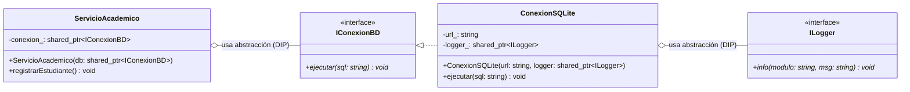

# Actividad 4: Integración GoF + SOLID — Análisis Crítico

## Código Analizado
```cpp
// ¿Qué patrón es esto? ¿Qué principios SOLID cumple?
class ConexionBD {
  static ConexionBD* _inst;
  std::string url_;
  ConexionBD() : url_("sqlite:///datos.db") {}
public:
  static ConexionBD* get() {
    if (!_inst) _inst = new ConexionBD();
    return _inst;
  }
  void ejecutar(const std::string& sql) {
    Logger::instancia().info("BD", "Ejecutando: " + sql);
    std::cout << "SQL: " << sql << std::endl;
  }
};
ConexionBD* ConexionBD::_inst = nullptr;
```

---

## Cuadro de Análisis Crítico Rellenado

| Pregunta | Tu respuesta |
| :--- | :--- |
| **¿Qué patrón GoF es?** | **Patrón Creacional Singleton Clásico (con inicialización perezosa / Lazy Initialization)**.<br>Su propósito es asegurar que solo exista una instancia de `ConexionBD` mediante un constructor privado, un puntero estático `_inst` y un método de acceso global estático `get()`. Además, colabora directamente invocando a otro Singleton: `Logger::instancia()`. |
| **¿Es thread-safe? ¿Por qué?** | **NO es thread-safe**.<br>Presenta una **condición de carrera (race condition)** crítica en la verificación no sincronizada `if (!_inst)`. Si múltiples hilos entran simultáneamente a `get()` cuando `_inst` es `nullptr`, varios hilos evaluarán la condición como verdadera y ejecutarán concurrentemente `new ConexionBD()`. Esto genera:<br>1. Creación de múltiples instancias en memoria (violando la invariante del patrón).<br>2. Fuga de memoria (*memory leak*) del objeto previamente apuntado.<br>3. *Data race* (comportamiento indefinido) al escribir en el puntero estático sin exclusión mutua. |
| **¿Qué principio SOLID aplica?** | **Aplica parcialmente SRP (Single Responsibility Principle) a nivel de dominio** en cuanto a que su propósito de negocio es centralizar la ejecución de sentencias SQL.<br>*(Nota pedagógica: desde el punto de vista puramente arquitectónico, está comprometido porque mezcla la lógica de conexión con la gestión de su propio ciclo de vida).* |
| **¿Qué principio SOLID viola?** | **1. Viola DIP (Dependency Inversion Principle) de manera grave en dos sentidos:**<br>• Internamente: Está rígidamente acoplada a la implementación concreta global `Logger::instancia()` en vez de depender de una abstracción (`ILogger`).<br>• Externamente: Los servicios de negocio que la llamen dependerán del método estático concreto `ConexionBD::get()`, impidiendo sustituir la base de datos por un mock en pruebas unitarias.<br>**2. Viola OCP (Open/Closed Principle):** La cadena de conexión `"sqlite:///datos.db"` está fija (*hardcodeada*). Para cambiar a PostgreSQL, MySQL o variar la base según el entorno (test vs producción), se requiere alterar el código fuente de la clase.<br>**3. Viola SRP:** Asume dos responsabilidades ortogonales: controlar la unicidad de su ciclo de vida y ejecutar consultas SQL.<br>**4. Defecto de diseño C++:** No eliminó el constructor de copia ni el operador de asignación (`= delete`), permitiendo duplicar el objeto con `ConexionBD copia = *ConexionBD::get();`. |
| **¿Cómo lo mejorarías?** | **1. Thread-safety idiomático (Meyers Singleton):** Reemplazar el puntero crudo con una variable estática local dentro de `get()` (`static ConexionBD inst; return inst;`), garantizada thread-safe por el estándar C++11/C++17 y destruida automáticamente al finalizar el programa.<br>**2. Eliminar copia y movimiento:** Declarar explícitamente `= delete` para `ConexionBD(const ConexionBD&)` y `operator=`.<br>**3. Aplicar DIP e Inyección de Dependencias:** Desacoplar la conexión detrás de una interfaz abstracta `IConexionBD`, recibir la URL por parámetro/archivo de configuración, e inyectar una abstracción `ILogger` por constructor.<br>**4. Arquitectura limpia:** Registrar la instancia como Singleton en un Contenedor de Inversión de Control (IoC/DI) en el punto de entrada de la aplicación, permitiendo inyectar fakes/mocks en pruebas sin variables globales estáticas. |

---

## Comparativa Técnica: Código Original vs Código Refactorizado


