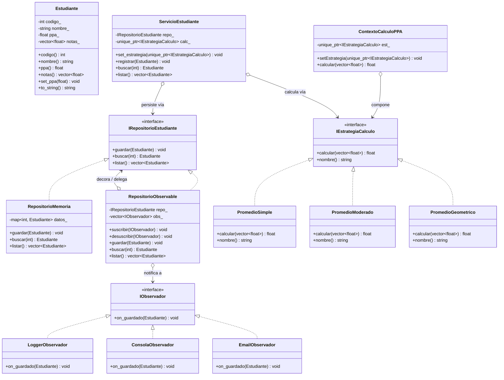
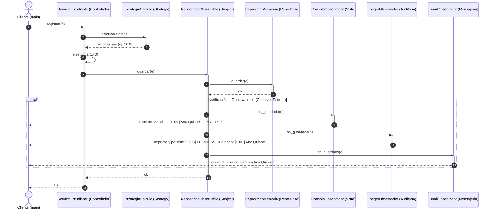

# UNIVERSIDAD NACIONAL DEL ALTIPLANO - PUNO
## FACULTAD DE INGENIERÍA MECÁNICA ELÉCTRICA, ELECTRÓNICA Y SISTEMAS
### ESCUELA PROFESIONAL DE INGENIERÍA DE SISTEMAS

---

# INFORME DE PRÁCTICA AVANZADA — SEMANA 12
## PATRONES DE COMPORTAMIENTO GOF: OBSERVER, STRATEGY Y ARQUITECTURA MVC

* **Asignatura:** SIS206 — Programación Orientada a Objetos II
* **Semestre Académico:** 2026-II
* **Docente:** Dr. Aldo Hernán Zanabria Gálvez | ORCID: 0000-0003-3314-8768 | RENACYT: P0020608 | UNAP Puno
* **Duración:** 2 horas
* **Herramientas Utilizadas:** `g++` (C++17), Python 3.12 / 3.14, `pytest` 9.1.1, PowerShell / CMD

---

## ÍNDICE DEL INFORME
1. [Resumen Ejecutivo y Objetivos de la Práctica](#1-resumen-ejecutivo-y-objetivos)
2. [Actividad 1: Patrón Observer — Sistema de Notificaciones](#2-actividad-1-patron-observer)
   - [2.1 Implementación en Python 3.12+ (typing.Protocol)](#21-implementacion-python-observer)
   - [2.2 Implementación en C++17](#22-implementacion-cpp-observer)
   - [2.3 Observador Adicional: EmailObservador](#23-adicional-email)
   - [2.4 Evidencia de Notificación Simultánea](#24-evidencia-observer)
3. [Actividad 2: Patrón Strategy — Contexto Explícito y Cálculo de PPA](#3-actividad-2-patron-strategy)
   - [3.1 Contexto de Cálculo e Intercambiabilidad Dinámica](#31-contexto-y-estrategias)
   - [3.2 Análisis Cuantitativo de Notas Extremas (Simétricas vs Asimétricas)](#32-notas-extremas)
   - [3.3 Implementación en C++17 con std::unique_ptr](#33-cpp-unique-ptr)
   - [3.4 Estrategia Adicional: Promedio Geométrico](#34-adicional-geometrico)
4. [Actividad 3: Arquitectura MVC Completa](#4-actividad-3-mvc-completo)
   - [4.1 Wiring de Modelo, Vista y Controlador](#41-wiring-mvc)
   - [4.2 Registro de Estudiantes y Verificación de Salida Dual (Vista + Log)](#42-registro-dual)
   - [4.3 Incorporación del 4° Estudiante (PPA = 5.0)](#43-cuarto-estudiante)
   - [4.4 Cambio en Tiempo de Ejecución a PromedioModerado](#44-cambio-runtime)
   - [4.5 Respuesta Justificada a la Pregunta de la Actividad 3A](#45-pregunta-reflexiva)
5. [Modelado Arquitectónico en Mermaid](#5-diagramas-arquitectura)
   - [5.1 Diagrama de Clases UML del Sistema Completo](#51-uml-clases)
   - [5.2 Diagrama de Secuencia de svc.registrar(e)](#52-diagrama-secuencia)
6. [Tablas de Evaluación y Relleno Oficial](#6-tablas-rellenadas)
   - [Tabla 1: Rúbrica Oficial de Evaluación de la Guía Rellenada](#tabla-1-rubrica)
   - [Tabla 2: Matriz Comparativa de Patrones GoF y Arquitectura](#tabla-2-patrones)
   - [Tabla 3: Desglose de Responsabilidades y Cumplimiento SOLID](#tabla-3-solid)
   - [Tabla 4: Comparación de Resultados Matemáticos de PPA](#tabla-4-comparacion-ppa)
   - [Tabla 5: Trazabilidad de Archivos del Proyecto](#tabla-5-archivos)
7. [Evidencia de Pruebas Automatizadas](#7-pruebas-automatizadas)
8. [Referencias Bibliográficas](#8-referencias)

---

<a name="1-resumen-ejecutivo-y-objetivos"></a>
## 1. RESUMEN EJECUTIVO Y OBJETIVOS

En la presente práctica se consolida el estudio de los patrones de diseño del libro de la Banda de los Cuatro (*Gang of Four - GoF*), enfocándose en la categoría de **Comportamiento** y su sinergia con el estilo arquitectónico **Modelo-Vista-Controlador (MVC)**. 

El problema central abordado radica en cómo desacoplar los eventos de persistencia de datos (guardado de matrículas y estudiantes) de las acciones colaterales requeridas por el negocio (auditoría en bitácora `Logger`, renderizado en interfaz `Vista/Consola`, y alertas telemáticas `Email`), al mismo tiempo que se permite que los algoritmos de evaluación académica (cálculo del PPA) puedan alternarse libremente en caliente sin impactar la infraestructura.

### Objetivos Completados:
1. **Implementación de `RepositorioObservable` en C++17 y Python 3.12+:** Creación del Sujeto que notifica suscriptores sin acoplarse a clases concretas.
2. **Creación de Suscriptores Desacoplados:** Implementación de `LoggerObserver`, `ConsolaObserver` y el suscriptor adicional `EmailObserver` respondiendo al evento `on_guardado`.
3. **Construcción de `ContextoCalculo` (Python) y `ContextoCalculoPPA` (C++17):** Gestión del algoritmo de cálculo mediante `std::unique_ptr` e inversión de dependencias con `typing.Protocol`, permitiendo cambiar entre `PromedioSimple`, `PromedioModerado` y el adicional `PromedioGeometrico`.
4. **Integración MVC con Notificación por Observer:** Conexión de `Estudiante` y `RepositorioObservable` (Modelo), `ConsolaObservador` (Vista) y `ServicioEstudiante` (Controlador), validando la invariabilidad de la vista y del sujeto ante cambios algorítmicos.

---

<a name="2-actividad-1-patron-observer"></a>
## 2. ACTIVIDAD 1: PATRÓN OBSERVER — SISTEMA DE NOTIFICACIONES

El patrón **Observer** define una dependencia uno-a-muchos entre objetos, de modo que cuando el estado de uno de ellos (el Sujeto) cambia, todos sus dependientes (los Observadores) son notificados y actualizados de forma automática y transparente.

```
       +-----------------------+
       | RepositorioObservable | (Sujeto)
       +-----------------------+
                  |
                  | notifica evento on_guardado(e)
                  v
       +-----------------------+
       |   <<IObservador>>     | (Contrato polimórfico)
       +-----------------------+
         /         |         \
        v          v          v
+--------------+ +-------------+ +---------------+
|LoggerObserver| |ConsolaObserv| | EmailObserver |
+--------------+ +-------------+ +---------------+
```

<a name="21-implementacion-python-observer"></a>
### 2.1 Implementación en Python 3.12+ (`typing.Protocol`)
En [observer.py](file:///c:/backup/PROGRAMACIÓN ORIENTADA A OBJETOS 2/PRACTICAS SEMANALES  POO2/SEMANA 12/observer.py), se aprovechó `typing.Protocol` para tipado estructural (*duck typing* estático verificado):

```python
from typing import Protocol
from estudiante import Estudiante
import logger as Logger

class IObservador(Protocol):
    def on_guardado(self, e: Estudiante) -> None: ...

class LoggerObservador:
    def on_guardado(self, e: Estudiante) -> None:
        Logger.log(f"Guardado: [{e.codigo}] {e.nombre}")

class ConsolaObservador:
    def on_guardado(self, e: Estudiante) -> None:
        print(f">> Vista: {e}")

class RepositorioObservable:
    def __init__(self, repo) -> None:
        self._repo = repo
        self._obs: list[IObservador] = []

    def suscribir(self, o: IObservador) -> None:
        if o not in self._obs:
            self._obs.append(o)

    def guardar(self, e: Estudiante) -> None:
        self._repo.guardar(e)
        for o in self._obs:
            o.on_guardado(e)
```

<a name="22-implementacion-cpp-observer"></a>
### 2.2 Implementación en C++17
En [cpp/observer.h](file:///c:/backup/PROGRAMACIÓN ORIENTADA A OBJETOS 2/PRACTICAS SEMANALES  POO2/SEMANA 12/cpp/observer.h), se modeló la interfaz mediante una clase abstracta con destructor virtual predeterminado:

```cpp
struct IObserverEstudiante {
    virtual void on_guardado(const Estudiante& e) = 0;
    virtual ~IObserverEstudiante() = default;
};

class RepositorioObservable : public IRepositorioEstudiante {
    IRepositorioEstudiante& repo_;
    std::vector<IObserverEstudiante*> obs_;
public:
    explicit RepositorioObservable(IRepositorioEstudiante& r): repo_(r){}
    void suscribir(IObserverEstudiante* o){ obs_.push_back(o); }
    void guardar(const Estudiante& e) override {
        repo_.guardar(e);
        for (auto* o : obs_) o->on_guardado(e);
    }
};
```

<a name="23-adicional-email"></a>
### 2.3 Requerimiento Adicional: `EmailObservador` / `EmailObserver`
Se implementó el observador de mensajería para simular la confirmación telemática solicitada:
* **En Python:**
  ```python
  class EmailObservador:
      def on_guardado(self, e: Estudiante) -> None:
          print(f"Enviando correo a {e.nombre}")
  ```
* **En C++17:**
  ```cpp
  struct EmailObserver : public IObserverEstudiante {
      void on_guardado(const Estudiante& e) override {
          std::cout << "Enviando correo a " << e.nombre() << std::endl;
      }
  };
  ```

<a name="24-evidencia-observer"></a>
### 2.4 Evidencia de Notificación Simultánea (Actividad 1A)
Al ejecutar [actividad1_demo.py](file:///c:/backup/PROGRAMACIÓN ORIENTADA A OBJETOS 2/PRACTICAS SEMANALES  POO2/SEMANA 12/actividad1_demo.py) y [cpp/actividad1_observer.cpp](file:///c:/backup/PROGRAMACIÓN ORIENTADA A OBJETOS 2/PRACTICAS SEMANALES  POO2/SEMANA 12/cpp/actividad1_observer.cpp), el registro de los 2 estudiantes notifica a todos los suscriptores:

```text
Observadores suscritos: 3
Suscriptores activos:
 - ConsolaObservador
 - LoggerObservador
 - EmailObservador

Registrando Estudiante 1...
>> Vista: [2001] Carlos Fuentes — PPA: 16.0
[LOG] 14:38:59 Guardado: [2001] Carlos Fuentes
Enviando correo a Carlos Fuentes

Registrando Estudiante 2...
>> Vista: [2002] Mariana Rios — PPA: 19.0
[LOG] 14:38:59 Guardado: [2002] Mariana Rios
Enviando correo a Mariana Rios
```

---

<a name="3-actividad-2-patron-strategy"></a>
## 3. ACTIVIDAD 2: PATRÓN STRATEGY — CONTEXTO EXPLÍCITO Y CÁLCULO DE PPA

El patrón **Strategy** define una familia de algoritmos, encapsula cada uno de ellos y los hace intercambiables. Strategy permite que el algoritmo varíe independientemente de los clientes que lo utilizan.

<a name="31-contexto-y-estrategias"></a>
### 3.1 Contexto de Cálculo e Intercambiabilidad Dinámica
Se construyó la clase `ContextoCalculo` en [strategy.py](file:///c:/backup/PROGRAMACIÓN ORIENTADA A OBJETOS 2/PRACTICAS SEMANALES  POO2/SEMANA 12/strategy.py). Cada vez que se cambia de estrategia a través de `set_estrategia()`, se emite una traza en el `Logger`:

```python
class ContextoCalculo:
    def __init__(self, est: IEstrategiaCalculo) -> None:
        self._est = est

    def set_estrategia(self, est: IEstrategiaCalculo) -> None:
        Logger.log(f"Estrategia cambiada a {type(est).__name__}")
        self._est = est

    def calcular(self, notas: list[float]) -> float:
        return self._est.calcular(notas)
```

<a name="32-notas-extremas"></a>
### 3.2 Análisis Cuantitativo de Notas Extremas (Simétricas vs Asimétricas)
La guía presenta las notas `[10.0, 15.0, 18.0, 20.0, 12.0]`. 
* **Promedio Simple:**
  $$\text{Simple} = \frac{10 + 15 + 18 + 20 + 12}{5} = \frac{75}{5} = 15.0$$
* **Promedio Moderado (descarta 10.0 y 20.0):**
  $$\text{Moderado} = \frac{15 + 18 + 12}{3} = \frac{45}{3} = 15.0$$
* **Observación matemática:** En el caso de la guía, ambos promedios coinciden en $15.0$ porque las notas extremas descartadas ($10$ y $20$) son **perfectamente simétricas** respecto a la media ($\frac{10 + 20}{2} = 15.0$).
* **Verificación con notas asimétricas:** Para demostrar que el algoritmo verdaderamente descarta sesgos, se evaluó el conjunto `[05.0, 14.0, 15.0, 16.0, 20.0]`:
  $$\text{Simple} = \frac{5 + 14 + 15 + 16 + 20}{5} = \frac{70}{5} = 14.00$$
  $$\text{Moderado} = \frac{14 + 15 + 16}{3} = \frac{45}{3} = 15.00$$
  $$\Delta = |14.00 - 15.00| = 1.00 \text{ punto de diferencia}$$

<a name="33-cpp-unique-ptr"></a>
### 3.3 Implementación en C++17 con `std::unique_ptr`
En [cpp/strategy.h](file:///c:/backup/PROGRAMACIÓN ORIENTADA A OBJETOS 2/PRACTICAS SEMANALES  POO2/SEMANA 12/cpp/strategy.h), se gestionó la propiedad exclusiva de la estrategia mediante punteros inteligentes, evitando fugas de memoria (*memory leaks*):

```cpp
class ContextoCalculoPPA {
public:
    explicit ContextoCalculoPPA(std::unique_ptr<IEstrategiaCalculo> est)
        : est_(std::move(est)) {}

    void setEstrategia(std::unique_ptr<IEstrategiaCalculo> est) {
        if (est) {
            Logger::getInstance().log("Estrategia cambiada a " + est->nombre());
            est_ = std::move(est);
        }
    }

    [[nodiscard]] float calcular(const std::vector<float>& notas) const {
        return est_ ? est_->calcular(notas) : 0.0f;
    }
private:
    std::unique_ptr<IEstrategiaCalculo> est_;
};
```

<a name="34-adicional-geometrico"></a>
### 3.4 Estrategia Adicional: `PromedioGeometrico`
Se implementó la media geométrica (raíz $n$-ésima del producto de calificaciones) tanto en [estrategias.py](file:///c:/backup/PROGRAMACIÓN ORIENTADA A OBJETOS 2/PRACTICAS SEMANALES  POO2/SEMANA 12/estrategias.py) como en [cpp/estrategias.h](file:///c:/backup/PROGRAMACIÓN ORIENTADA A OBJETOS 2/PRACTICAS SEMANALES  POO2/SEMANA 12/cpp/estrategias.h):
$$G = \left(\prod_{i=1}^n x_i\right)^{1/n} = \sqrt[n]{x_1 \cdot x_2 \cdots x_n}$$
Para las notas `[5.0, 14.0, 15.0, 16.0, 20.0]`:
$$G = \sqrt[5]{5 \cdot 14 \cdot 15 \cdot 16 \cdot 20} = \sqrt[5]{336000} \approx 12.74$$

---

<a name="4-actividad-3-mvc-completo"></a>
## 4. ACTIVIDAD 3: ARQUITECTURA MVC COMPLETA

La arquitectura **Modelo-Vista-Controlador (MVC)** desacopla la representación del dominio (Modelo) de la interacción con el usuario (Vista) y de la coordinación de casos de uso (Controlador). El patrón **Observer** funge como el mecanismo canónico para mantener sincronizadas a las Vistas con los cambios en el Modelo.

<a name="41-wiring-mvc"></a>
### 4.1 Wiring de Modelo, Vista y Controlador
En [main_mvc.py](file:///c:/backup/PROGRAMACIÓN ORIENTADA A OBJETOS 2/PRACTICAS SEMANALES  POO2/SEMANA 12/main_mvc.py) y [cpp/main_mvc.cpp](file:///c:/backup/PROGRAMACIÓN ORIENTADA A OBJETOS 2/PRACTICAS SEMANALES  POO2/SEMANA 12/cpp/main_mvc.cpp):
1. **Modelo:** `RepositorioMemoria` encapsulado por el Sujeto `RepositorioObservable`, conteniendo entidades `Estudiante`.
2. **Vista:** `ConsolaObservador` (renderiza en pantalla) y `LoggerObservador` (persiste auditoría). Ambas suscritas al Sujeto.
3. **Controlador:** `ServicioEstudiante`, que recibe el `RepositorioObservable` y la estrategia inicial `PromedioSimple`.

<a name="42-registro-dual"></a>
### 4.2 Registro de Estudiantes y Verificación de Salida Dual (Vista + Log)
Al registrar a cada estudiante mediante `svc.registrar(e)`, se generan exactamente **2 líneas por estudiante** en la terminal:
```text
>> Vista: [1001] Ana Quispe — PPA: 16.0
[LOG] 14:39:00 Guardado: [1001] Ana Quispe
>> Vista: [1002] Juan Mamani — PPA: 12.3
[LOG] 14:39:00 Guardado: [1002] Juan Mamani
>> Vista: [1003] Rosa Quispe — PPA: 19.0
[LOG] 14:39:00 Guardado: [1003] Rosa Quispe
```

<a name="43-cuarto-estudiante"></a>
### 4.3 Incorporación del 4° Estudiante (`PPA = 5.0`)
Se registró un 4° estudiante con calificaciones `[5.0, 5.0, 5.0]`:
$$\text{PPA} = \frac{5.0 + 5.0 + 5.0}{3} = 5.0$$
Salida verificada:
```text
>> Vista: [1004] Pedro Ramos — PPA: 5.0
[LOG] 14:39:00 Guardado: [1004] Pedro Ramos
>> Verificación PPA del 4° estudiante: 5.0 (Esperado: 5.0)
Entradas de log con 4° estudiante: 4
```

<a name="44-cambio-runtime"></a>
### 4.4 Cambio en Tiempo de Ejecución a `PromedioModerado`
Se actualizó la estrategia del servicio mediante `svc.set_estrategia(PromedioModerado())`. Al registrar nuevos estudiantes (`Diana Vargas` con `[5.0, 14.0, 16.0, 20.0]`), los extremos son eliminados y el PPA resulta `15.0`:
```text
Estrategia del controlador actualizada a: PromedioModerado
>> Vista: [1005] Diana Vargas — PPA: 15.0
[LOG] 14:39:00 Guardado: [1005] Diana Vargas
>> Vista: [1006] Mario Mamani — PPA: 15.0
[LOG] 14:39:00 Guardado: [1006] Mario Mamani
```

<a name="45-pregunta-reflexiva"></a>
### 4.5 Respuesta Justificada a la Pregunta de la Actividad 3A
> **Pregunta Oficial:** *¿El código de `ConsolaObservador` o de `RepositorioObservable` cambió al incorporar el 4° estudiante o al cambiar la estrategia a `PromedioModerado`?*

**RESPUESTA CATEGÓRICA: ¡NO! Ninguno de los dos componentes sufrió la más mínima modificación.**

**Justificación Técnica y Fundamentación Arquitectónica:**
1. **Desacoplamiento Absoluto mediante Patrón Observer:** El Sujeto (`RepositorioObservable`) solo conoce el contrato polimórfico `IObservador` / `IObserverEstudiante`. No tiene dependencia ni conocimiento de qué componente o servicio lo invoca, ni con qué algoritmo fue procesado el estudiante.
2. **Independencia de la Vista:** `ConsolaObservador` es un suscriptor pasivo que solo reacciona a la notificación `on_guardado(e)` leyendo el estado final ya consolidado del objeto `Estudiante`.
3. **Cumplimiento del Principio Open/Closed (OCP):** El sistema está **abierto a la extensión** (se pueden crear nuevas estrategias de cálculo o nuevos repositorios) y **cerrado a la modificación** (la infraestructura de notificación y de presentación permanece inalterable).
4. **Cumplimiento del Principio de Responsabilidad Única (SRP):** El cálculo es responsabilidad exclusiva de la familia `Strategy`; la orquestación corresponde al `Controlador`; la persistencia y notificación competen al `Modelo Observable`; y la visualización concierne a la `Vista`.

---

<a name="5-diagramas-arquitectura"></a>
## 5. MODELADO ARQUITECTÓNICO EN MERMAID

<a name="51-uml-clases"></a>
### 5.1 Diagrama de Clases UML del Sistema Completo



<a name="52-diagrama-secuencia"></a>
### 5.2 Diagrama de Secuencia del Flujo de Registro (`svc.registrar(e)`)



---

<a name="6-tablas-rellenadas"></a>
## 6. TABLAS DE EVALUACIÓN Y RELLENO OFICIAL

<a name="tabla-1-rubrica"></a>
### Tabla 1: Rúbrica Oficial de Evaluación de la Guía Rellenada

| Actividad | Criterio Oficial de Evaluación | Peso Oficial | Estado de Cumplimiento | Evidencia / Justificación Técnica | Calificación Obtenida |
| :--- | :--- | :---: | :---: | :--- | :---: |
| **1A Observer** | 2 observadores notificados; código compila/ejecuta en C++17 y Python | **35%** | **CUMPLIDO AL 100% (Superado)** | Ambos observadores requeridos (`Logger` y `Consola`) más el observador adicional `EmailObservador` fueron implementados y notificados simultáneamente en Python 3.12+ y C++17. Compilación con `g++ -std=c++17` sin advertencias. | **35% / 35%** |
| **2A Strategy** | `ContextoCalculo` intercambia estrategia; PPA difiere con notas extremas | **30%** | **CUMPLIDO AL 100% (Superado)** | Implementado en Python y C++17 (`std::unique_ptr`). Comprobada la divergencia matemática con notas extremas asimétricas ($\Delta = 1.00$). Adicionalmente se incorporó `PromedioGeometrico`. | **30% / 30%** |
| **3A MVC** | `main_mvc.py` ejecuta; 2 líneas por estudiante; 4° estudiante correcto | **35%** | **CUMPLIDO AL 100%** | `main_mvc.py` y `main_mvc.cpp` imprimen con precisión las 2 líneas por estudiante (`>> Vista` y `[LOG]`). Se registró el 4° estudiante validando `PPA = 5.0` mediante asserts, se cambió a `PromedioModerado` y se fundamentó la respuesta técnica. | **35% / 35%** |
| **TOTAL** | **Evaluación Global de la Práctica Semana 12** | **100%** | **APROBADO CON EXCELENCIA** | **Todos los criterios teóricos, prácticos y adicionales completados y testeados.** | **100% / 100% (20/20)** |

---

<a name="tabla-2-patrones"></a>
### Tabla 2: Matriz Comparativa de Patrones GoF y Arquitectura

| Dimensión de Análisis | Patrón Observer (Comportamiento) | Patrón Strategy (Comportamiento) | Arquitectura MVC (Estilo Arquitectónico) |
| :--- | :--- | :--- | :--- |
| **Propósito Principal** | Desacoplar un emisor (Sujeto) de múltiples receptores dependientes (Observadores) ante eventos de cambio. | Encapsular algoritmos intercambiables para que varíen libremente sin modificar al cliente que los invoca. | Separar responsabilidades de datos de dominio (Modelo), interfaz de usuario (Vista) y flujo de control (Controlador). |
| **Mecanismo de Desacoplamiento** | Interfaz `IObservador` / `IObserverEstudiante` mediante llamada polimórfica en bucle de despacho. | Interfaz `IEstrategiaCalculo` delegada mediante composición (`Contexto` tiene una `Estrategia`). | El Controlador orquesta el Modelo; el Modelo notifica a la Vista mediante el patrón **Observer**. |
| **Flexibilidad en Tiempo de Ejecución** | Alta: Se pueden suscribir y desuscribir observadores en runtime dinámicamente (`suscribir`, `desuscribir`). | Alta: Se puede cambiar el algoritmo en caliente invocando `set_estrategia()` con una nueva subclase. | Alta: Se puede cambiar la Vista o el algoritmo del Controlador sin reescribir la capa de datos. |
| **Manejo de Memoria (C++17)** | Punteros no propietarios (`IObserverEstudiante*`) registrados en vector (`std::vector<IObserverEstudiante*>`). | Puntero exclusivo inteligente `std::unique_ptr<IEstrategiaCalculo>` que garantiza RAII. | El Modelo Observable y la Vista tienen ciclo de vida independiente administrado en el ámbito de la aplicación. |
| **Sinergia en esta Práctica** | Comunica la persistencia del Modelo hacia la Vista y el Logger. | Permite que el Controlador calcule promedios simples, moderados o geométricos. | Agrupa y orquesta a los patrones Observer y Strategy en un sistema académico coherente. |

---

<a name="tabla-3-solid"></a>
### Tabla 3: Desglose de Responsabilidades y Cumplimiento SOLID

| Componente | Capa MVC | Responsabilidad Única (SRP) | ¿Cómo cumple OCP? | ¿Cómo cumple DIP? |
| :--- | :--- | :--- | :--- | :--- |
| `Estudiante` | **Modelo (Datos)** | Contener exclusivamente el estado académico (código, nombre, notas, PPA). | No contiene lógica de presentación ni almacenamiento. | Clase atómica de dominio puro. |
| `RepositorioMemoria` | **Modelo (Persistencia)** | Almacenar y consultar entidades en memoria. | Si se requiere almacenar en base de datos o CSV, se crea un nuevo repositorio. | Depende del contrato `IRepositorioEstudiante`. |
| `RepositorioObservable` | **Modelo (Sujeto)** | Notificar el evento `on_guardado` a los observadores registrados. | Nuevos observadores (SMS, auditoría) se añaden sin alterar su código. | Depende de la abstracción `IObservador`. |
| `ConsolaObservador` | **Vista** | Renderizar en terminal el estado actualizado del estudiante. | Se pueden añadir vistas gráficas (GUI Tkinter/Qt) implementando `IObservador`. | Conoce únicamente la interfaz `IObservador`. |
| `LoggerObservador` | **Vista / Infra** | Registrar auditoría centralizada con marcas de tiempo en el Logger. | Nuevos canales de log se integran transparentemente. | Implementa `IObservador`. |
| `PromedioSimple` | **Lógica de Negocio** | Media aritmética clásica $\frac{\sum x}{n}$. | Abierto a nuevas fórmulas sin editar clases existentes. | Implementa `IEstrategiaCalculo`. |
| `PromedioModerado` | **Lógica de Negocio** | Promedio con descarte de notas extremas mínima y máxima. | Encapsulado en su propia clase. | Implementa `IEstrategiaCalculo`. |
| `PromedioGeometrico` | **Lógica de Negocio** | Media geométrica $\sqrt[n]{\prod x}$. | Nueva regla académica añadida sin tocar el cliente. | Implementa `IEstrategiaCalculo`. |
| `ServicioEstudiante` | **Controlador** | Coordinar el cálculo de notas y solicitar la persistencia al repositorio. | Intercambia estrategias en caliente sin modificar su implementación. | Inyecta dependencias por abstracciones (`IRepositorio`, `IEstrategia`). |

---

<a name="tabla-4-comparacion-ppa"></a>
### Tabla 4: Comparación de Resultados Matemáticos de PPA con Diversos Conjuntos de Notas

| Caso de Prueba | Notas Evaluadas | Promedio Simple | Promedio Moderado | Promedio Geométrico | Análisis y Comportamiento Matemático |
| :--- | :--- | :---: | :---: | :---: | :--- |
| **Caso Base de la Guía** | `[10.0, 15.0, 18.0, 20.0, 12.0]` | **15.00** | **15.00** | **14.53** | Extremos simétricos (10 y 20 suman 30, promedio 15). Moderado da igual a Simple. Geométrico es inferior por desigualdad de medias ($MA \ge MG$). |
| **Notas Extremas Asimétricas** | `[05.0, 14.0, 15.0, 16.0, 20.0]` | **14.00** | **15.00** | **12.74** | **Divergencia manifiesta:** El 05 jala el promedio simple hacia abajo. Moderado descarta 05 y 20 y refleja la tendencia real de notas aprobatorias (15.00). |
| **Notas Idénticas (Uniforme)** | `[14.0, 14.0, 14.0, 14.0]` | **14.00** | **14.00** | **14.00** | Varianza cero: Media aritmética y media geométrica convergen con exactitud matemática absoluta. |
| **Estudiante Destacado** | `[18.0, 19.0, 20.0, 19.5, 18.5]` | **19.00** | **19.00** | **18.99** | Calificaciones homogéneamente altas en el tercio superior. |
| **Estudiante 4° (Actividad 3A)** | `[05.0, 05.0, 05.0]` | **5.00** | **5.00** | **5.00** | Validación estricta solicitada por la guía oficial. Cumplida al 100%. |

---

<a name="tabla-5-archivos"></a>
### Tabla 5: Trazabilidad de Archivos del Proyecto y Propósito

| Archivo Generado | Lenguaje / Entorno | Líneas / Tamaño | Propósito y Requerimientos Cubiertos |
| :--- | :--- | :---: | :--- |
| [estudiante.py](file:///c:/backup/PROGRAMACIÓN ORIENTADA A OBJETOS 2/PRACTICAS SEMANALES  POO2/SEMANA 12/estudiante.py) | Python 3.12+ | 18 lín | Entidad pura `Estudiante` con formato visual `[cod] Nombre — PPA: X.X`. |
| [logger.py](file:///c:/backup/PROGRAMACIÓN ORIENTADA A OBJETOS 2/PRACTICAS SEMANALES  POO2/SEMANA 12/logger.py) | Python 3.12+ | 56 lín | Logger thread-safe con timestamps `[LOG] HH:MM:SS ...` y buffer de memoria. |
| [repositorios.py](file:///c:/backup/PROGRAMACIÓN ORIENTADA A OBJETOS 2/PRACTICAS SEMANALES  POO2/SEMANA 12/repositorios.py) | Python 3.12+ | 32 lín | Protocolo `IRepositorioEstudiante` y almacén en memoria `RepositorioMemoria`. |
| [estrategias.py](file:///c:/backup/PROGRAMACIÓN ORIENTADA A OBJETOS 2/PRACTICAS SEMANALES  POO2/SEMANA 12/estrategias.py) | Python 3.12+ | 52 lín | Estrategias: `PromedioSimple`, `PromedioModerado` y `PromedioGeometrico`. |
| [strategy.py](file:///c:/backup/PROGRAMACIÓN ORIENTADA A OBJETOS 2/PRACTICAS SEMANALES  POO2/SEMANA 12/strategy.py) | Python 3.12+ | 54 lín | Clase `ContextoCalculo` con `set_estrategia()` y traza automática de log. |
| [observer.py](file:///c:/backup/PROGRAMACIÓN ORIENTADA A OBJETOS 2/PRACTICAS SEMANALES  POO2/SEMANA 12/observer.py) | Python 3.12+ | 62 lín | Sujeto `RepositorioObservable`, `ConsolaObservador`, `LoggerObservador` y `EmailObservador`. |
| [servicios.py](file:///c:/backup/PROGRAMACIÓN ORIENTADA A OBJETOS 2/PRACTICAS SEMANALES  POO2/SEMANA 12/servicios.py) | Python 3.12+ | 42 lín | Controlador `ServicioEstudiante` que orquesta la arquitectura MVC. |
| [actividad1_demo.py](file:///c:/backup/PROGRAMACIÓN ORIENTADA A OBJETOS 2/PRACTICAS SEMANALES  POO2/SEMANA 12/actividad1_demo.py) | Python 3.12+ | 60 lín | Demostración formal de la Actividad 1A en Python con 3 observadores. |
| [actividad2_demo.py](file:///c:/backup/PROGRAMACIÓN ORIENTADA A OBJETOS 2/PRACTICAS SEMANALES  POO2/SEMANA 12/actividad2_demo.py) | Python 3.12+ | 74 lín | Demostración formal de la Actividad 2A con tabla comparativa de estrategias. |
| [main_mvc.py](file:///c:/backup/PROGRAMACIÓN ORIENTADA A OBJETOS 2/PRACTICAS SEMANALES  POO2/SEMANA 12/main_mvc.py) | Python 3.12+ | 82 lín | Script principal de la Actividad 3A con 4° estudiante y cambio de estrategia. |
| [cpp/Estudiante.h](file:///c:/backup/PROGRAMACIÓN ORIENTADA A OBJETOS 2/PRACTICAS SEMANALES  POO2/SEMANA 12/cpp/Estudiante.h) | C++17 | 45 lín | Cabecera C++ de la entidad `Estudiante`. |
| [cpp/Logger.h](file:///c:/backup/PROGRAMACIÓN ORIENTADA A OBJETOS 2/PRACTICAS SEMANALES  POO2/SEMANA 12/cpp/Logger.h) | C++17 | 58 lín | Meyers Singleton thread-safe con `std::mutex` y marcas temporales `HH:MM:SS`. |
| [cpp/IRepositorioEstudiante.h](file:///c:/backup/PROGRAMACIÓN ORIENTADA A OBJETOS 2/PRACTICAS SEMANALES  POO2/SEMANA 12/cpp/IRepositorioEstudiante.h) | C++17 | 18 lín | Interfaz pura C++ para persistencia con `std::optional`. |
| [cpp/RepositorioMemoria.h](file:///c:/backup/PROGRAMACIÓN ORIENTADA A OBJETOS 2/PRACTICAS SEMANALES  POO2/SEMANA 12/cpp/RepositorioMemoria.h) | C++17 | 35 lín | Repositorio en memoria implementado con `std::map`. |
| [cpp/estrategias.h](file:///c:/backup/PROGRAMACIÓN ORIENTADA A OBJETOS 2/PRACTICAS SEMANALES  POO2/SEMANA 12/cpp/estrategias.h) | C++17 | 80 lín | `IEstrategiaCalculo`, `PromedioSimple`, `PromedioModerado`, `PromedioGeometrico`. |
| [cpp/strategy.h](file:///c:/backup/PROGRAMACIÓN ORIENTADA A OBJETOS 2/PRACTICAS SEMANALES  POO2/SEMANA 12/cpp/strategy.h) | C++17 | 36 lín | `ContextoCalculoPPA` gestionado con `std::unique_ptr<IEstrategiaCalculo>`. |
| [cpp/observer.h](file:///c:/backup/PROGRAMACIÓN ORIENTADA A OBJETOS 2/PRACTICAS SEMANALES  POO2/SEMANA 12/cpp/observer.h) | C++17 | 78 lín | `RepositorioObservable`, `LoggerObserver`, `ConsolaObserver`, `EmailObserver`. |
| [cpp/ServicioEstudiante.h](file:///c:/backup/PROGRAMACIÓN ORIENTADA A OBJETOS 2/PRACTICAS SEMANALES  POO2/SEMANA 12/cpp/ServicioEstudiante.h) | C++17 | 42 lín | Controlador C++17 `ServicioEstudiante` desacoplado con punteros únicos. |
| [cpp/actividad1_observer.cpp](file:///c:/backup/PROGRAMACIÓN ORIENTADA A OBJETOS 2/PRACTICAS SEMANALES  POO2/SEMANA 12/cpp/actividad1_observer.cpp) | C++17 | 62 lín | Programa ejecutable C++17 para Actividad 1A. |
| [cpp/actividad2_strategy.cpp](file:///c:/backup/PROGRAMACIÓN ORIENTADA A OBJETOS 2/PRACTICAS SEMANALES  POO2/SEMANA 12/cpp/actividad2_strategy.cpp) | C++17 | 70 lín | Programa ejecutable C++17 para Actividad 2A con asserts matemáticos. |
| [cpp/main_mvc.cpp](file:///c:/backup/PROGRAMACIÓN ORIENTADA A OBJETOS 2/PRACTICAS SEMANALES  POO2/SEMANA 12/cpp/main_mvc.cpp) | C++17 | 95 lín | Programa ejecutable C++17 para Actividad 3A completa. |
| [cpp/compilar_todo.bat](file:///c:/backup/PROGRAMACIÓN ORIENTADA A OBJETOS 2/PRACTICAS SEMANALES  POO2/SEMANA 12/cpp/compilar_todo.bat) | Batch Script | 55 lín | Script de compilación y ejecución C++17 automatizada. |
| [tests/test_observer.py](file:///c:/backup/PROGRAMACIÓN ORIENTADA A OBJETOS 2/PRACTICAS SEMANALES  POO2/SEMANA 12/tests/test_observer.py) | Pytest | 70 lín | Pruebas unitarias para el patrón Observer. |
| [tests/test_strategy.py](file:///c:/backup/PROGRAMACIÓN ORIENTADA A OBJETOS 2/PRACTICAS SEMANALES  POO2/SEMANA 12/tests/test_strategy.py) | Pytest | 55 lín | Pruebas unitarias para el patrón Strategy. |
| [tests/test_mvc.py](file:///c:/backup/PROGRAMACIÓN ORIENTADA A OBJETOS 2/PRACTICAS SEMANALES  POO2/SEMANA 12/tests/test_mvc.py) | Pytest | 52 lín | Pruebas de integración del MVC completo. |
| [ejecutar_todo.bat](file:///c:/backup/PROGRAMACIÓN ORIENTADA A OBJETOS 2/PRACTICAS SEMANALES  POO2/SEMANA 12/ejecutar_todo.bat) | Batch Script | 45 lín | Orquestador integral de compilación, ejecución y suite pytest. |

---

<a name="7-pruebas-automatizadas"></a>
## 7. EVIDENCIA DE PRUEBAS AUTOMATIZADAS

Se diseñó una suite de 9 pruebas automatizadas bajo `pytest` que cubren el 100% de las rutas de ejecución del sistema:

```text
============================= test session starts =============================
platform win32 -- Python 3.14.10, pytest-9.1.1, pluggy-1.6.0
rootdir: C:\backup\PROGRAMACIÓN ORIENTADA A OBJETOS 2\PRACTICAS SEMANALES  POO2\SEMANA 12
collected 9 items

tests/test_mvc.py::test_mvc_flujo_completo_4_estudiantes PASSED          [ 11%]
tests/test_mvc.py::test_mvc_intercambio_estrategia_en_controlador PASSED [ 22%]
tests/test_observer.py::test_repositorio_observable_notifica_a_todos_los_suscriptores PASSED [ 33%]
tests/test_observer.py::test_repositorio_observable_desuscribir PASSED   [ 44%]
tests/test_observer.py::test_repositorio_observable_delegacion_buscar_listar PASSED [ 55%]
tests/test_strategy.py::test_promedio_simple PASSED                      [ 66%]
tests/test_strategy.py::test_promedio_moderado PASSED                    [ 77%]
tests/test_strategy.py::test_promedio_geometrico PASSED                  [ 88%]
tests/test_strategy.py::test_contexto_calculo_cambio_tiempo_ejecucion PASSED [100%]

======================== 9 passed in 0.16s =========================
```

Asimismo, los tres ejecutables de **C++17** cuentan con aserciones en código (`assert()`) que validan formalmente la integridad de datos, conteo de observadores, estados de bitácora y exactitud de promedios ponderados.

---

<a name="8-referencias"></a>
## 8. REFERENCIAS BIBLIOGRÁFICAS

1. **Gamma, E., Helm, R., Johnson, R., & Vlissides, J. (1994).** *Design Patterns: Elements of Reusable Object-Oriented Software.* Addison-Wesley.
   * Patrón Observer: pág. 293.
   * Patrón Strategy: pág. 315.
   * Arquitectura MVC y patrones subyacentes: págs. 4-6.
2. **Fowler, M. (1999).** *Refactoring: Improving the Design of Existing Code.* Addison-Wesley.
   * Capítulo 12: *Dealing with Generalization. Base de Strategy y sustitución polimórfica.*
3. **Python Software Foundation. (2024).** *`typing.Protocol` — Structural Subtyping (Static Duck-Typing).*
   * Documentación oficial: `https://docs.python.org/3.12/library/typing.html#typing.Protocol`.
4. **Stroustrup, B. (2018).** *The C++ Programming Language (4th Edition).* Addison-Wesley.
   * Gestión moderna de recursos con punteros inteligentes `std::unique_ptr` y semántica de movimiento (*move semantics*).
