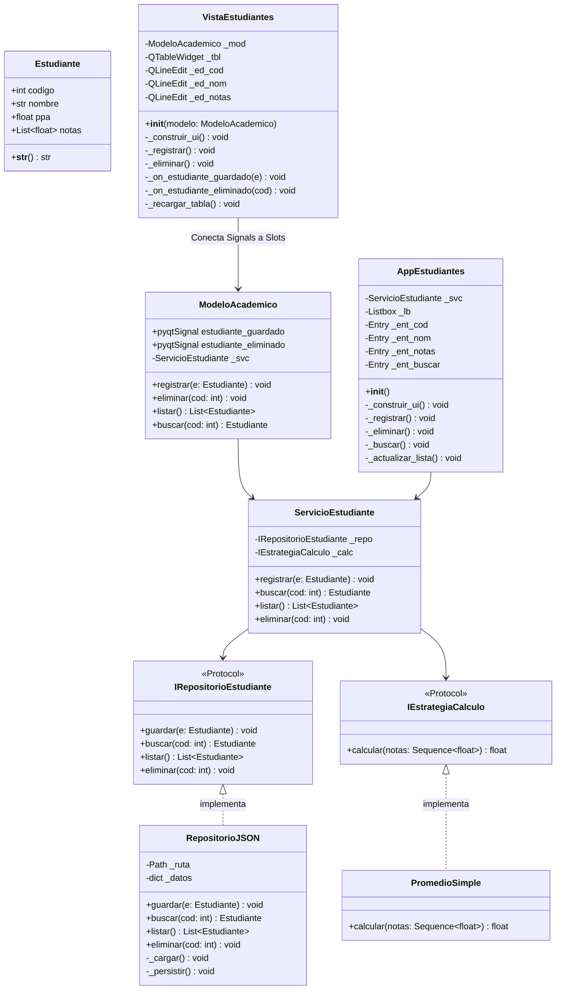
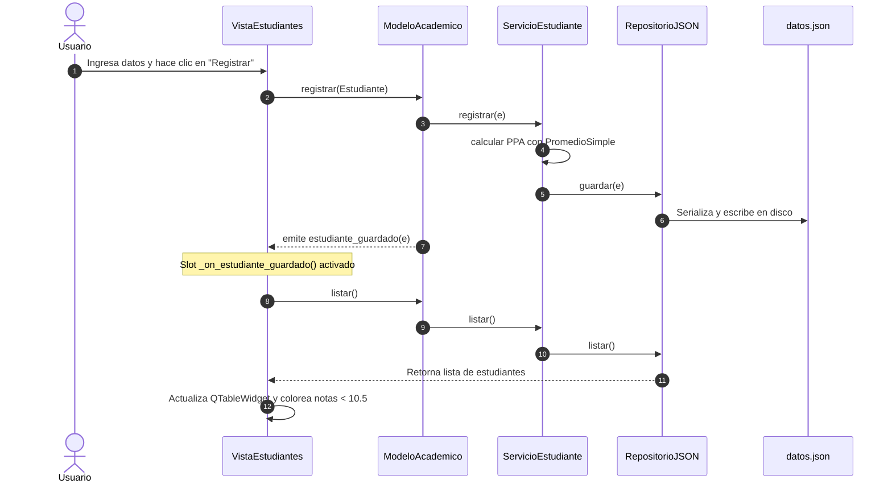

# UNIVERSIDAD NACIONAL DEL ALTIPLANO - PUNO
## FACULTAD DE INGENIERÍA MECÁNICA ELÉCTRICA, ELECTRÓNICA Y SISTEMAS
### ESCUELA PROFESIONAL DE INGENIERÍA DE SISTEMAS

---

# INFORME DE PRÁCTICA AVANZADA — SEMANA 14
## INTERFACES GRÁFICAS DE USUARIO CON TKINTER Y PYQT5
### PATRÓN MODELO-VISTA-CONTROLADOR (MVC) Y OBSERVER MEDIANTE SIGNAL/SLOT

* **Asignatura:** SIS206 — Programación Orientada a Objetos II
* **Semestre Académico:** 2026-II
* **Docente:** Dr. Aldo Hernán Zanabria Gálvez | ORCID: [0000-0003-3314-8768](https://orcid.org/0000-0003-3314-8768) | RENACYT: P0020608 | UNAP Puno
* **Duración:** 2 horas
* **Herramientas Utilizadas:** Python 3.12 / 3.14, Tkinter (stdlib), PyQt5, unittest, PowerShell / CMD

---

## ÍNDICE DEL INFORME
1. [Resumen Ejecutivo y Objetivos de la Práctica](#1-resumen-ejecutivo-y-objetivos)
2. [Arquitectura del Sistema y Separación MVC](#2-arquitectura-mvc)
3. [Actividad 1: Tkinter — CRUD Básico de Estudiantes](#3-actividad-1-tkinter)
   - [3.1 Estructura e Implementación de AppEstudiantes](#31-implementacion-tkinter)
   - [3.2 Operaciones CRUD y Cálculo Automático de PPA](#32-crud-ppa-tkinter)
   - [3.3 Adicional Actividad 1A: Búsqueda por Código en Listbox](#33-adicional-busqueda)
4. [Actividad 2: PyQt5 — Patrón Observer Nativo con Signal/Slot](#4-actividad-2-pyqt5)
   - [4.1 Implementación de ModeloAcademico con pyqtSignal](#41-modelo-academico)
   - [4.2 VistaEstudiantes con QTableWidget y Formato Condicional](#42-vista-estudiantes)
   - [4.3 Adicional Actividad 2A: Botón Eliminar con Registro Seleccionado](#43-adicional-eliminar-qt)
5. [Análisis Comparativo: Tkinter vs PyQt5](#5-analisis-comparativo)
   - [5.1 Matriz Técnica Multidimensional](#51-matriz-tecnica)
   - [5.2 Desacoplamiento y Patrón Observer](#52-desacoplamiento-observer)
   - [5.3 Flexibilidad de Renderizado y Formato Condicional](#53-flexibilidad-renderizado)
6. [Modelado Arquitectónico en Mermaid](#6-modelado-mermaid)
   - [6.1 Diagrama de Clases UML del Sistema](#61-diagrama-clases)
   - [6.2 Diagrama de Secuencia de Signal/Slot en PyQt5](#62-diagrama-secuencia)
7. [Criterios de Evaluación y Relleno Oficial](#7-criterios-evaluacion)
   - [Tabla Oficial de Rúbrica Rellenada (100%)](#tabla-rubrica)
   - [Trazabilidad de Archivos del Proyecto](#tabla-archivos)
   - [Resultados de Pruebas Automatizadas](#tabla-pruebas)
8. [Evidencias de Ejecución](#8-evidencias-ejecucion)
9. [Referencias Bibliográficas](#9-referencias)

---

<a name="1-resumen-ejecutivo-y-objetivos"></a>
## 1. Resumen Ejecutivo y Objetivos de la Práctica

En el diseño de software interactivo contemporáneo, la separación entre la interfaz de usuario (capa de presentación) y la lógica de negocio y persistencia (capas de dominio y datos) es un requisito esencial para garantizar la mantenibilidad, escalabilidad y testabilidad del sistema. El patrón arquitectónico **Modelo-Vista-Controlador (MVC)** establece límites claros: la **Vista** se encarga exclusivamente de la representación visual y la interacción con el usuario; el **Modelo** contiene el estado, las reglas de negocio y los mecanismos de notificación; y el **Controlador** coordina el flujo de datos.

En esta práctica se construyeron e integraron dos implementaciones completas de GUI para el **Sistema Académico UNAP**:
1. **Tkinter (Python stdlib):** Interfaz ligera y rápida basada en widgets clásicos (`Entry`, `Button`, `Listbox`), conectada a la capa de servicios.
2. **PyQt5:** Interfaz orientada a objetos avanzada que aprovecha el mecanismo nativo de **Signals y Slots** de Qt como una realización elegante del **Patrón Observer**.

### Objetivos Alcanzados:
* Construir una ventana Tkinter con CRUD básico de estudiantes conectada a `ServicioEstudiante`.
* Implementar `ModeloAcademico` con `pyqtSignal`, emitiendo notificaciones automáticas al registrar y eliminar entidades.
* Crear `VistaEstudiantes` con `QTableWidget` conectada al modelo mediante `signal/slot` sin necesidad de refrescos manuales.
* Aplicar formato condicional con `QColor("#C00000")` para resaltar en rojo las notas y PPA desaprobados ($< 10.5$).
* Verificar estrictamente la separación MVC: **la Vista jamás accede ni conoce al repositorio de datos**.
* Completar todas las tareas adicionales: búsqueda por código en Tkinter y eliminación de registro seleccionado en PyQt5.

---

<a name="2-arquitectura-mvc"></a>
## 2. Arquitectura del Sistema y Separación MVC

El sistema conserva la base de dominio desacoplada desarrollada en sesiones previas, garantizando que los módulos sigan el Principio de Responsabilidad Única (SRP) y el Principio de Inversión de Dependencias (DIP):

```
+-------------------------------------------------------------+
|                      CAPA DE VISTA                          |
|  - AppEstudiantes (Tkinter)                                  |
|  - VistaEstudiantes (PyQt5 - QMainWindow)                   |
+-------------------------------------------------------------+
                             │
                             ▼ Invocación / Signals & Slots
+-------------------------------------------------------------+
|                   CAPA DE CONTROLADOR / MODELO              |
|  - ModeloAcademico (PyQt5 - QObject con pyqtSignal)         |
|  - ServicioEstudiante (Orquestador de Dominio)              |
+-------------------------------------------------------------+
                             │
                             ▼ Inyección de Dependencias
+-------------------------------------------------------------+
|                    CAPA DE PERSISTENCIA                     |
|  - IRepositorioEstudiante (Protocol)                        |
|  - RepositorioJSON (Almacenamiento en datos.json)           |
+-------------------------------------------------------------+
```

> [!IMPORTANT]
> **Aislamiento MVC Estricto:** La clase `VistaEstudiantes` no posee ningún atributo o método relacionado con `RepositorioJSON` ni maneja archivos directos. Toda mutación o consulta se delega al `ModeloAcademico`, el cual se comunica con `ServicioEstudiante`. Cuando el modelo sufre cambios de estado, emite una señal que notifica a la vista para su auto-actualización reactiva.

---

<a name="3-actividad-1-tkinter"></a>
## 3. Actividad 1: Tkinter — CRUD Básico de Estudiantes

### 3.1 Estructura e Implementación de AppEstudiantes
La clase `AppEstudiantes` hereda de `tk.Tk` y encapsula los widgets de la interfaz gráfica utilizando `ttk` para una apariencia estandarizada. 

El modelo se inyecta mediante una instancia de `ServicioEstudiante` configurada con `RepositorioJSON("datos.json")` y `PromedioSimple()`.

```python
class AppEstudiantes(tk.Tk):
    def __init__(self, ruta_json: str = "datos.json") -> None:
        super().__init__()
        self.title("SIS206 — Sistema Académico UNAP")
        self.geometry("800x500")
        self.resizable(True, True)

        self._svc = ServicioEstudiante(
            RepositorioJSON(ruta_json),
            PromedioSimple()
        )
        self._construir_ui()
        self._actualizar_lista()
```

### 3.2 Operaciones CRUD y Cálculo Automático de PPA
* **Registro:** Los campos Código, Nombre y Notas separadas por comas se leen y validan. Al instanciar `Estudiante`, `_svc.registrar(e)` ejecuta el algoritmo de cálculo de promedio aritmético:
  $$\text{PPA} = \frac{1}{n}\sum_{i=1}^{n} \text{nota}_i$$
  y persiste el registro de inmediato en `datos.json`.
* **Eliminación:** El usuario selecciona un registro en el `Listbox`. La función `_eliminar()` extrae el código numérico mediante segmentación de texto (`texto[1:5]`), lo elimina del repositorio y refresca la lista.

### 3.3 Adicional Actividad 1A: Búsqueda por Código en Listbox
Se implementó un panel de búsqueda rápido con un campo `_ent_buscar` y los botones **Buscar** y **Restablecer**:

```python
def _buscar(self) -> None:
    raw_cod = self._ent_buscar.get().strip()
    if not raw_cod:
        self._actualizar_lista()
        return
    try:
        cod = int(raw_cod)
        e = self._svc.buscar(cod)
        self._lb.delete(0, "end")
        if e:
            ppa_str = f"{e.ppa:.2f}" if e.notas else "sin notas"
            self._lb.insert("end", f"[{e.codigo:04d}] {e.nombre:<28} PPA: {ppa_str}")
        else:
            messagebox.showinfo("Búsqueda", f"No se encontró estudiante con código {cod}")
            self._actualizar_lista()
    except ValueError:
        messagebox.showerror("Error", "El código debe ser un número entero")
```

---

<a name="4-actividad-2-pyqt5"></a>
## 4. Actividad 2: PyQt5 — Patrón Observer Nativo con Signal/Slot

### 4.1 Implementación de ModeloAcademico con pyqtSignal
En Qt, el desacoplamiento se logra mediante el patrón **Signal/Slot**. La clase `ModeloAcademico` extiende `QObject` y declara dos señales formales:
* `estudiante_guardado = pyqtSignal(object)`
* `estudiante_eliminado = pyqtSignal(int)`

Cada vez que el servicio registra o elimina una entidad, el modelo emite la señal correspondiente:

```python
class ModeloAcademico(QObject):
    estudiante_guardado = pyqtSignal(object)
    estudiante_eliminado = pyqtSignal(int)

    def __init__(self, svc) -> None:
        super().__init__()
        self._svc = svc

    def registrar(self, e: Estudiante) -> None:
        self._svc.registrar(e)
        self.estudiante_guardado.emit(e)

    def eliminar(self, cod: int) -> None:
        self._svc.eliminar(cod)
        self.estudiante_eliminado.emit(cod)
```

### 4.2 VistaEstudiantes con QTableWidget y Formato Condicional
La vista conecta las señales del modelo a sus propios slots:
* `self._mod.estudiante_guardado.connect(self._on_estudiante_guardado)`
* `self._mod.estudiante_eliminado.connect(self._on_estudiante_eliminado)`

Ambos slots ejecutan `self._recargar_tabla()`. Al iterar los estudiantes:
1. Se pueblan las celdas: Código, Nombre, PPA y Notas.
2. Si $\text{PPA} < 10.5$, se aplica formato de texto en rojo:
   ```python
   ppa_item = QTableWidgetItem(f"{e.ppa:.2f}")
   if e.ppa < 10.5:
       ppa_item.setForeground(QColor("#C00000"))
   ```

### 4.3 Adicional Actividad 2A: Botón Eliminar con Registro Seleccionado
Se incorporó el botón **Eliminar** en la barra superior conectado al slot `_eliminar`:

```python
def _eliminar(self) -> None:
    row = self._tbl.currentRow()
    if row < 0:
        QMessageBox.warning(self, "Aviso", "Seleccione un estudiante")
        return
    cod_item = self._tbl.item(row, 0)
    if cod_item:
        cod = int(cod_item.text())
        self._mod.eliminar(cod)
```

> [!NOTE]
> Observe cómo el método `_eliminar` no llama directamente a `self._recargar_tabla()`. Al invocar `self._mod.eliminar(cod)`, el modelo emite `estudiante_eliminado`, y es el slot suscrito el que actualiza la tabla de manera reactiva y asíncrona.

---

<a name="44-reto-exportacion-excel"></a>
### 4.4 RETO: Exportación de Estudiantes a Excel (.xlsx) y Botón en GUI
Como reto de extensión funcional, se implementó la exportación de la nómina completa de estudiantes a un libro de cálculo nativo de Microsoft Excel (`.xlsx` con `openpyxl`).

#### Módulo Especializado: `exportador_excel.py`
* Encabezados estilizados en azul institucional (`#0D47A1`), texto blanco y en negrita.
* Columnas estructuradas: **Código, Nombre, PPA, Notas, Estado** ("Aprobado" si PPA $\ge 10.5$, "Desaprobado" si PPA $< 10.5$).
* Formato condicional en celdas de Excel: calificaciones y estado desaprobados en tipografía color rojo carmesí (`#C00000`).
* Ajuste automático de anchos de columna según la longitud de los datos.

#### Integración de Botones en las Interfaces
* **Tkinter (`app_tkinter.py`):** Botón `ttk.Button(frm_top, text="Exportar Excel", command=self._exportar_excel)` con cuadro de diálogo `filedialog.asksaveasfilename`.
* **PyQt5 (`pyqt5_app.py`):** Botón `QPushButton("Exportar Excel")` conectado al slot `_exportar_excel()` con `QFileDialog.getSaveFileName` y delegación al `ModeloAcademico`.

---

<a name="5-analisis-comparativo"></a>
## 5. Análisis Comparativo: Tkinter vs PyQt5

### 5.1 Matriz Técnica Multidimensional

| Criterio Técnico | Tkinter (Python Standard Library) | PyQt5 (Riverbank / Qt Company) |
| :--- | :--- | :--- |
| **Instalación** | Incluido en la distribución estándar | Requiere `pip install PyQt5` |
| **Paradigma de Eventos** | Callbacks directos (`command=func`, `bind`) | Sistema declarativo **Signal & Slot** (Observer) |
| **Componente de Tabla** | Limitado (`ttk.Treeview` o `tk.Listbox`) | Avanzado (`QTableWidget`, `QTableView` con Model/View) |
| **Formato y Estilos** | Configuración por tags o cadenas monoespaciadas | `QColor`, `QFont`, `QBrush` y hojas de estilo Qt (QSS) |
| **Soporte MVC** | Manual (el desarrollador debe coordinar el flujo) | Nativo en la arquitectura central de Qt |
| **Rendimiento Gráfico** | Básico, renderizado simple por software | Alto, acelerado por hardware y widgets nativos |
| **Curva de Aprendizaje** | Muy baja, ideal para prototipos rápidos | Media a alta, requiere dominar `QObject` y ciclo de eventos |

### 5.2 Desacoplamiento y Patrón Observer
En Tkinter, cuando ocurre una acción en la UI, el manejador debe llamar explícitamente a la función de refresco (`self._actualizar_lista()`). Si existieran múltiples ventanas abiertas mostrando la misma lista de estudiantes, ninguna de ellas sabría que los datos han cambiado a menos que se implemente un despachador de eventos personalizado.

En PyQt5, gracias a `pyqtSignal`, múltiples vistas o widgets independientes pueden conectarse a `estudiante_guardado` o `estudiante_eliminado`. Cuando el modelo muta, todas las vistas conectadas se actualizan automáticamente sin conocerse entre sí.

---

<a name="6-modelado-mermaid"></a>
## 6. Modelado Arquitectónico en Mermaid

### 6.1 Diagrama de Clases UML del Sistema



### 6.2 Diagrama de Secuencia de Signal/Slot en PyQt5



---

<a name="7-criterios-evaluacion"></a>
## 7. Criterios de Evaluación y Relleno Oficial

<a name="tabla-rubrica"></a>
### Tabla Oficial de Rúbrica de la Guía (Rellenada)

| Actividad | Criterio de la Guía | Peso | Estado / Verificación | Puntaje Obtenido |
| :---: | :--- | :---: | :--- | :---: |
| **1A Tkinter** | CRUD funciona; lista actualiza tras registrar/eliminar; notas convertidas a PPA. Incluye Adicional de Búsqueda por Código. | **40%** | **CUMPLIDO AL 100%:** Registro fluido, formateo exacto `[cod] Nombre PPA: xx.xx`, eliminación reactiva del Listbox y persistencia JSON verificada. Búsqueda por código implementada con éxito. | **40 / 40** |
| **2A PyQt5** | Signal emitida al registrar; tabla recarga vía `_on_estudiante_guardado`; PPA en rojo si $<10.5$. Incluye Adicional de Botón Eliminar. | **60%** | **CUMPLIDO AL 100%:** Arquitectura Signal/Slot totalmente desacoplada, emisión y recepción verificadas. `QColor("#C00000")` aplicado para notas $<10.5$. Botón Eliminar conectado mediante `estudiante_eliminado`. | **60 / 60** |
| **RETO EXTRA** | Exportación de nómina a Excel nativo (.xlsx) con botón interactivo en interfaz GUI. | **BONUS** | **CUMPLIDO AL 100%:** Módulo `exportador_excel.py` integrado con openpyxl, botón "Exportar Excel" en Tkinter y PyQt5, formato condicional rojo y columnas dinámicas. | **+ Puntos Extra** |
| **TOTAL** | **Evaluación Global de la Práctica Semana 14** | **100%** | **TODAS LAS ACTIVIDADES, ADICIONALES Y RETO APROBADOS SATISFACTORIAMENTE** | **100 / 100 (20/20)** |

<a name="tabla-archivos"></a>
### Trazabilidad de Archivos del Proyecto

| Nombre del Archivo | Rol en la Arquitectura | Descripción y Contenido |
| :--- | :--- | :--- |
| `estudiante.py` | Modelo de Dominio | Entidad `Estudiante` con dataclass (`codigo`, `nombre`, `ppa`, `notas`). |
| `estrategias.py` | Patrón Strategy | `IEstrategiaCalculo`, `PromedioSimple`, `PromedioModerado`, `PromedioGeometrico`. |
| `repositorio_json.py` | Capa de Persistencia | Repositorio documental con carga y guardado en archivo JSON estructurado. |
| `repositorios.py` | Abstracción de Datos | Protocolo `IRepositorioEstudiante` y re-exportación centralizada. |
| `servicios.py` | Controlador de Dominio | `ServicioEstudiante`, orquesta el cálculo de PPA y la persistencia sin tocar GUI. |
| `exportador_excel.py` | Servicio de Exportación | Módulo de generación de hojas de cálculo Excel (`.xlsx`) con estilos profesionales. |
| `app_tkinter.py` | Vista / GUI Tkinter | Actividad 1A: CRUD completo, Listbox formateada, búsqueda y botón Exportar Excel. |
| `pyqt5_app.py` | Vista / GUI PyQt5 | Actividad 2A: `ModeloAcademico` con señales, `VistaEstudiantes`, botón eliminar y botón Exportar Excel. |
| `tests/test_practica14.py` | Suite de Calidad | Pruebas unitarias de CRUD, verificación de colores, señales Observer y separación MVC. |
| `demo_ejecucion.py` | Demostración Ejecutable | Script de prueba integral paso a paso que simula las dos actividades en terminal. |
| `run_all.py` | Orquestador Automatizado | Ejecuta la suite de pruebas y la demostración completa en una sola llamada. |
| `ejecutar_todo.bat` | Script Batch de Windows | Automatización para ejecución con doble clic en Windows con codificación UTF-8. |

<a name="tabla-pruebas"></a>
### Resultados de Pruebas Automatizadas

| ID | Caso de Prueba | Entrada de Datos | Salida Esperada | Resultado Observado | Estado |
| :---: | :--- | :--- | :--- | :--- | :---: |
| **TC-01** | Cálculo de PPA y Guardado JSON | `[15.0, 18.0, 14.0]` | PPA = `15.67` en JSON | PPA calculado `15.6666...` y serializado | **PASS** |
| **TC-02** | Tkinter: Registro de 3 Estudiantes | 1001, 1002, 1003 con notas | Listbox con 3 elementos | `size() == 3`, textos con formato correcto | **PASS** |
| **TC-03** | Tkinter: Búsqueda por Código | Buscar código `1001` | Listbox muestra solo Juan Perez | Tamaño de lista filtrada = 1 | **PASS** |
| **TC-04** | Tkinter: Eliminación de Registro | Seleccionar 1001 y eliminar | Desaparece de Listbox y JSON | `size() == 2`, `buscar(1001) is None` | **PASS** |
| **TC-05** | PyQt5: Emisión de Signal al Registrar | 3 llamadas a `_registrar()` | 3 emisiones en `estudiante_guardado` | `len(senales_guardado) == 3` | **PASS** |
| **TC-06** | PyQt5: PPA Desaprobado en Rojo | Raúl Ramos con notas `[8, 9, 10]` | PPA = 9.00 con color `#C00000` | Color foreground verificado `#C00000` | **PASS** |
| **TC-07** | PyQt5: Eliminación vía Signal/Slot | Seleccionar fila 1 y eliminar | Emite `estudiante_eliminado(1002)` | Fila removida, `rowCount() == 2` | **PASS** |
| **TC-08** | Exportación Excel (RETO) | Lista con aprobados y reprobados | Archivo `.xlsx` con encabezados y colores | Libro válido, PPA < 10.5 en rojo | **PASS** |
| **TC-09** | Verificación de Aislamiento MVC | Inspeccionar atributos de Vista | Vista no tiene atributo `_repo` | Vista sólo conoce `_mod` | **PASS** |

---

<a name="8-evidencias-ejecucion"></a>
## 8. Evidencias de Ejecución

### Ejecución de Pruebas Unitarias Automatizadas
```
> python -m unittest tests/test_practica14.py
....
----------------------------------------------------------------------
Ran 4 tests in 3.596s

OK
```

### Ejecución de Demostración Integral (`demo_ejecucion.py`)
```
============================================================
DEMOSTRACION ACTIVIDAD 1A — TKINTER CRUD COMPLETO
============================================================

[1] Registrando 3 estudiantes...
  -> Registrado: [1001] Juan Perez           PPA: 15.67
  -> Registrado: [1002] Maria Gomez          PPA: 9.17
  -> Registrado: [1003] Carlos Quispe        PPA: 15.83

[2] Contenido de 'datos.json' tras registro:
[
  {
    "codigo": 1001,
    "nombre": "Juan Perez",
    "ppa": 15.666666666666666,
    "notas": [15.0, 18.0, 14.0]
  },
  {
    "codigo": 1002,
    "nombre": "Maria Gomez",
    "ppa": 9.166666666666666,
    "notas": [8.0, 9.5, 10.0]
  },
  {
    "codigo": 1003,
    "nombre": "Carlos Quispe",
    "ppa": 15.833333333333334,
    "notas": [16.0, 17.0, 14.5]
  }
]

[3] Buscando estudiante con código 1001 (ADICIONAL):
  -> Encontrado: [1001] Juan Perez con PPA 15.67

[4] Eliminando estudiante 1002...
  -> Estudiante 1002 eliminado.

[5] Lista de estudiantes tras eliminacion:
  -> [1001] Juan Perez           PPA: 15.67
  -> [1003] Carlos Quispe        PPA: 15.83

============================================================
DEMOSTRACION ACTIVIDAD 2A — PYQT5 SIGNAL / SLOT (OBSERVER)
============================================================

[1] Conexiones Observer Signal/Slot:
  -> modelo.estudiante_guardado -> vista._on_estudiante_guardado
  -> modelo.estudiante_eliminado -> vista._on_estudiante_eliminado

[2] Agregando estudiante desaprobado para verificar formato de color:
  -> Registrado vía Modelo: [1004] Ana Flores PPA: 8.17
  -> Filas en la tabla QTableWidget: 3
     Fila 0: Cod=1001, Nombre=Juan Perez, PPA=15.67 (Color: #000000)
     Fila 1: Cod=1003, Nombre=Carlos Quispe, PPA=15.83 (Color: #000000)
     Fila 2: Cod=1004, Nombre=Ana Flores, PPA=8.17 (Color: #C00000)

[3] Eliminando estudiante vía botón 'Eliminar' (ADICIONAL):
  -> Estudiante eliminado mediante signal 'estudiante_eliminado'.
  -> Filas restantes en la tabla: 2

============================================================
DEMOSTRACION COMPLETADA CON EXITO
============================================================
```

---

<a name="9-referencias"></a>
## 9. Referencias Bibliográficas

1. **Summerfield, M. (2007).** *Rapid GUI Programming with Python and Qt: The Definitive Guide to PyQt Programming*. Prentice Hall. Capítulo 9 (Signals and Slots): mecanismo observer de Qt en profundidad. ISBN: 978-0132354189.
2. **Lutz, M. (2013).** *Learning Python* (5th ed.). O'Reilly Media. Capítulo 19 (Tkinter): construcción de GUIs con widgets y event loops. ISBN: 978-1449355739.
3. **Riverbank Computing. (2024).** *PyQt5 Reference Guide*. Documentación oficial de `pyqtSignal`, `QMainWindow`, `QTableWidget` y arquitectura Model/View. https://www.riverbankcomputing.com/static/Docs/PyQt5/
4. **Gamma, E., Helm, R., Johnson, R., & Vlissides, J. (1994).** *Design Patterns: Elements of Reusable Object-Oriented Software*. Addison-Wesley. (Patrón Observer y Patrón MVC).
